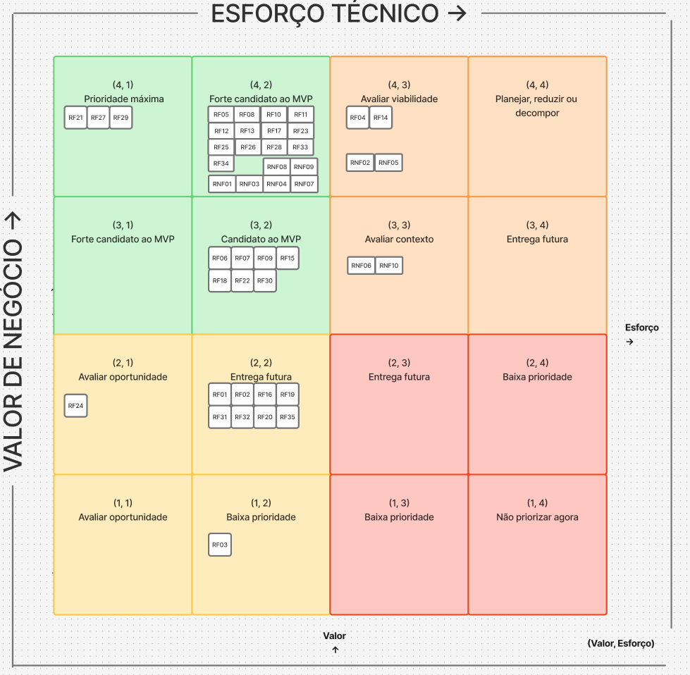

# 10 BACKLOG DO PRODUTO 

| Tema relacionado | ID | Épico | User Stories relacionadas | Regras de negócio | Requisitos não funcionais |
| --- | --- | --- | --- | --- | --- |
| T01 | EP01 | Triagem e direcionamento | US01 | RN01, RN02 | RNF01, RNF07, RNF09 |
| T02 | EP02 | Descoberta de experiências e pacotes | US02, US03, US24 | — | RNF01, RNF03, RNF07 |
| T02 | EP03 | Conta do cliente | US04, US05, US06, US07, US23 | RN03 | RNF01, RNF04, RNF08 |
| T02 | EP04 | Reserva e pagamento | US08, US09, US10 | RN04 | RNF01, RNF02, RNF04, RNF05, RNF08 |
| T02 | EP05 | Gestão de experiências e pacotes | US11, US12 | — | RNF01, RNF04 |
| T03 | EP06 | Conta e perfil do voluntário | US15, US17, US22, US23 | RN03 | RNF01, RNF04, RNF08 |
| T03 | EP07 | Descoberta e candidatura | US14, US16, US21 | — | RNF01, RNF04, RNF07, RNF08 |
| T03 | EP08 | Gestão de oportunidades e candidatos | US13, US18 | RN05 | RNF01, RNF04, RNF08 |
| T04 | EP09 | Solicitação e análise de parcerias | US19, US20 | — | RNF01, RNF04, RNF07, RNF08 |

## 10.1 Backlog Geral

O backlog geral reúne as funcionalidades, regras de negócio e requisitos de qualidade planejados para a plataforma do IBRADA. Ele representa o escopo conhecido do produto e possui caráter evolutivo: seus itens podem ser detalhados, divididos, reordenados ou revistos conforme novos aprendizados, validações com os stakeholders e restrições técnicas sejam identificados.

Os itens do backlog foram originados a partir das características de produto, dos objetivos específicos e dos valores de negócio definidos no [Documento de Visão](2_solucao.md). Suas descrições completas e relações de rastreabilidade estão disponíveis no [Catálogo de Requisitos](8_requisitos.md). Nesta seção, o backlog é apresentado de maneira consolidada; sua avaliação, priorização e o recorte do Produto Mínimo Viável (MVP) são apresentados na Seção 10.2.

### 10.1.1 Composição e rastreabilidade do backlog

O backlog contém elementos de diferentes naturezas, que devem permanecer relacionados sem serem tratados como equivalentes, a legenda se encontra no [glossário](../documentacao/glossario.md)

A rastreabilidade adotada segue, de forma geral, a seguinte relação:

```text
Objetivo Específico e Valor de Negócio
                  ↓
     Característica de Produto (CP)
                  ↓
          RF, RN e RNF relacionados
                  ↓
         Tema → Épico → User Story
                  ↓
          Critérios de Aceitação
```

### 10.1.2 Escolha do backlog

Como complemento à prototipação evolutiva do RAD e ao caráter ágil da abordagem híbrida adotada, os itens priorizados são refinados progressivamente em temas, épicos e histórias de usuário.

- **Tema:** representa uma área estratégica de valor e utiliza como referência as características de produto.
- **Épico:** representa um resultado amplo de usuário ou de negócio, ainda grande demais para ser implementado diretamente em uma única iteração.
- **User Story:** representa uma entrega pequena, implementável e testável, escrita preferencialmente no formato: `Como <usuário>, quero <objetivo>, para <benefício ou valor>`.
- **Critérios de Aceitação:** definem as condições objetivas que devem ser atendidas para que uma história seja considerada aceita.

Os itens mais próximos do desenvolvimento recebem maior nível de detalhamento, enquanto itens planejados para horizontes posteriores podem permanecer inicialmente como requisitos ou épicos. Esse refinamento progressivo evita detalhamento antecipado desnecessário e permite incorporar feedback dos stakeholders ao backlog.

As histórias de usuário devem explicitar valor para o usuário ou para a organização e ser verificadas quanto à independência, negociabilidade, valor, estimabilidade, tamanho e testabilidade. As regras de negócio e os requisitos não funcionais aplicáveis devem ser registrados junto às histórias ou aos seus critérios de aceitação.

As políticas de entrada e saída do fluxo de desenvolvimento são mantidas separadamente:

- a **Definition of Ready (DoR)** estabelece as condições mínimas para que uma história possa ser planejada e implementada;
- a **Definition of Done (DoD)** estabelece as condições comuns para que um incremento seja considerado concluído.

Essa separação evita utilizar a DoR ou a DoD como substitutas dos critérios de aceitação específicos de cada história.

## 10.2 Priorização do backlog e MVP

### 10.2.1 Critérios usados

Para a priorização do backlog avaliamos cada requisito funcional nos seguintes critérios: 

- **Valor de Negócio**: (0,4 x **MoSCoW**) +  (0,6 x **Frequência de uso**)

Usamos dois critérios para definir o valor de negócio que recebem valores de acordo com a sua especificação, o primeiro é o MosCow que é classificado como:

| Pontuação | Classificação | Interpretação |
| --- | --- | --- |
| **4** | Must have | Requisito indispensável para atender uma necessidade central do IBRADA, viabilizar um fluxo principal do produto, atender obrigação relevante ou permitir o funcionamento de outras funcionalidades. |
| **3** | Should have | Requisito importante e com impacto significativo, mas cuja ausência temporária não impede o funcionamento dos principais fluxos do produto. |
| **2** | Could have | Requisito que agrega valor à solução, porém pode ser implementado posteriormente sem comprometer os objetivos principais da primeira versão. |
| **1** | Won't have now | Requisito de baixo valor para o momento atual, podendo ser planejado para versões futuras sem impacto relevante sobre o funcionamento inicial da solução. |

E o segundo é a frequencia de uso:

| Pontuação  | Interpretação |
| --- | --- |
| **4** | diariamente/semanalmente |
| **3** | mensalmente |
| **2** | semestralmente |
| **1** | anualmente |

O peso maior na frequencia foca em entregar ao cliente um produto inicial que cubra as principais funcionalidades que ele deseja e usa mais no seu contexto inicial.

Para os requisitos não funcionais o valor de negócio leva em consideração apenas o contexto do projeto.

- **Esforço técnico**: (Esforço + Complexidade + Lacuna de capacidade) / 3

A avaliação técnica tanto dos funcionais quanto dos não funcionais foi realizada pela equipe do projeto considerando três critérios: **esforço necessário para implementação**, **complexidade técnica** e **lacuna de capacidade da equipe**.

> Utilizamos formulários onlines para capturar esses dados.

Cada critério foi avaliado em uma escala de **1 a 4**, orientada de modo que valores maiores representem maior dificuldade para implementação.


=== "Esforço de implementação"

    | Pontuação | Interpretação | Descrição |
    | --- | --- | --- |
    | **1** | Esforço baixo | Até 2 horas |
    | **2** | Esforço moderado | Entre 2 e 6 horas |
    | **3** | Esforço alto | Entre 6 e 12 horas |
    | **4** | Esforço muito alto | Mais de 12 horas |

=== "Complexidade técnica"

    | Pontuação | Interpretação |
    | --- | --- |
    | **1** | Utiliza solução conhecida, com poucas dependências |
    | **2** | Exige alguma investigação ou integração |
    | **3** | Possui várias dependências ou incertezas técnicas |
    | **4** | Apresenta elevada incerteza, integração crítica ou tecnologia não dominada |

=== "Capacidade da equipe"

    | Pontuação | Interpretação |
    | --- | --- |
    | **1** | A equipe domina plenamente os conhecimentos necessários |
    | **2** | A equipe possui conhecimento suficiente, com pouca aprendizagem adicional |
    | **3** | A equipe precisa desenvolver conhecimentos relevantes |
    | **4** | A equipe ainda não possui os conhecimentos ou recursos necessários |

[Tabelas com todos os valores detalhados antes de calcular as médias](../entrega-atividades/classificacao-requisitos.md) 

### 10.2.2 Tabela de critérios

Após todos os calculos, a tabela final ficou assim:

> Para visualizar o que cada requisito é consultar o catálogo de requisitos no [8. Requisitos de Software](../documento-visao/8_requisitos.md)

| ID | Relação | Avaliação MoSCoW | Avaliação Frequência de Uso | Esforço Técnico |
| --- | --- | --- | --- | --- |
| [RF01](8_requisitos.md#L11) | [CP1](2_solucao.md#L18) | 3 | 2 | 2,17 |
| [RF02](8_requisitos.md#L12) | [CP1](2_solucao.md#L18) | 3 | 2 | 1,67 |
| [RF03](8_requisitos.md#L13) | [CP1](2_solucao.md#L18) | 3 | 1 | 1,50 |
| [RF04](8_requisitos.md#L14) | [CP1](2_solucao.md#L18) | 4 | 4 | 2,89 |
| [RF05](8_requisitos.md#L15) | [CP2](2_solucao.md#L19) | 4 | 4 | 1,83 |
| [RF06](8_requisitos.md#L16)| [CP3](2_solucao.md#L20) | 4 | 3 | 1,78 |
| [RF07](8_requisitos.md#L17) | [CP3](2_solucao.md#L20) | 3 | 3 | 1,61 |
| [RF08](8_requisitos.md#L18) | [CP3](2_solucao.md#L20) | 4 | 4 | 1,72 |
| [RF09](8_requisitos.md#L19) | [CP3](2_solucao.md#L20) | 4 | 3 | 1,50 |
| [RF10](8_requisitos.md#L20) | [CP3](2_solucao.md#L20) | 4 | 4 | 2,06 |
| [RF11](8_requisitos.md#L21) | [CP3](2_solucao.md#L20) | 4 | 4 | 1,50 |
| [RF12](8_requisitos.md#L22) | [CP3](2_solucao.md#L20) | 4 | 4 | 2,22 |
| [RF13](8_requisitos.md#L23) | [CP3](2_solucao.md#L20) | 4 | 4 | 1,72 |
| [RF14](8_requisitos.md#L24) | [CP3](2_solucao.md#L20) | 4 | 4 | 3,39 |
| [RF15](8_requisitos.md#L25) | [CP3](2_solucao.md#L20) | 3 | 3 | 1,67 |
| [RF16](8_requisitos.md#L26) | [CP3](2_solucao.md#L20) | 2 | 2 | 1,56 |
| [RF17](8_requisitos.md#L27) | [CP3](2_solucao.md#L20) | 4 | 4 | 1,61 |
| [RF18](8_requisitos.md#L28) | [CP4](2_solucao.md#L21) | 4 | 3 | 2,06 |
| [RF19](8_requisitos.md#L29) | [CP4](2_solucao.md#L21) | 4 | 2 | 1,61 |
| [RF20](8_requisitos.md#L30) | [CP4](2_solucao.md#L21) | 4 | 2 | 2,22 |
| [RF21](8_requisitos.md#L31) | [CP4](2_solucao.md#L21) | 4 | 4 | 1,44 |
| [RF22](8_requisitos.md#L32) | [CP4](2_solucao.md#L21) | 4 | 3 | 1,50 |
| [RF23](8_requisitos.md#L33) | [CP4](2_solucao.md#L21) | 4 | 4 | 1,89 |
| [RF24](8_requisitos.md#L34) | [CP4](2_solucao.md#L21) | 4 | 2 | 1,39 |
| [RF25](8_requisitos.md#L35) | [CP4](2_solucao.md#L21) | 4 | 4 | 1,72 |
| [RF26](8_requisitos.md#L36) | [CP4](2_solucao.md#L21) | 4 | 4 | 2,00 |
| [RF27](8_requisitos.md#L37) | [CP4](2_solucao.md#L21) | 4 | 4 | 1,39 |
| [RF28](8_requisitos.md#L38) | [CP4](2_solucao.md#L21) | 4 | 4 | 1,94 |
| [RF29](8_requisitos.md#L39) | [CP4](2_solucao.md#L21) | 4 | 4 | 1,44 |
| [RF30](8_requisitos.md#L40) | [CP5](2_solucao.md#L22) | 4 | 3 | 2,11 |
| [RF31](8_requisitos.md#L41) | [CP5](2_solucao.md#L22) | 3 | 2 | 2,33 |
| [RF32](8_requisitos.md#L42) | [CP5](2_solucao.md#L22) | 2 | 3 | 1,94 |
| [RF33](8_requisitos.md#L43) | [CP6](2_solucao.md#L23) | 4 | 4 | 1,56 |
| [RF34](8_requisitos.md#L44) | [CP6](2_solucao.md#L23) | 4 | 4 | 1,61 |
| [RF35](8_requisitos.md#L45) | [CP6](2_solucao.md#L23) | 2 | 2 | 1,78 |
| RNF01 | Transversal — todas as CPs | 4 |-| 2 |
| RNF02 | CP3 | 4 |-| 3 |
| RNF03 | CP1 e CP3 | 4 |-| 2 |
| RNF04 | Transversal — CP1, CP3, CP4 e CP6 | 4 |-| 2 |
| RNF05 | CP3 | 4 |-| 3 |
| RNF06 | CP1, CP3 e CP5 | 3 |-| 3 |
| RNF07 | Transversal — todas as CPs | 4 |-| 2 |
| RNF08 | CP3, CP4 e CP6 | 4 |-| 2 |
| RNF09 | CP2 | 4 |-| 2 |
| RNF10 | Transversal — todas as CPs | 3 |-| 3 |


### 10.2.3 Matriz 4 x 4

Após a consolidação das avaliações de valor de negócio e esforço técnico, os requisitos funcionais foram posicionados em uma matriz **4 × 4**, permitindo visualizar conjuntamente a importância de cada requisito para o negócio e o esforço necessário para sua implementação.

Para o posicionamento no eixo horizontal, o esforço técnico consolidado foi convertido para a escala de 1 a 4 conforme o valor obtido na avaliação técnica:

O eixo vertical representa o **valor de negócio**, avaliado junto ao cliente, enquanto o eixo horizontal representa o **esforço técnico**, avaliado pela equipe.

| **Valor de negócio ↓ / Esforço técnico →** | **1 — Baixo** | **2 — Moderado** | **3 — Alto** | **4 — Muito alto** |
| --- | --- | --- | --- | --- |
| **4 — Muito alto** | **RF21, RF27, RF29** | **RF05, RF08, RF10, RF11, RF12, RF13, RF17, RF23, RF25, RF26, RF28, RF33, RF34, RNF01, RNF03, RNF04, RNF07, RNF08, RNF09** | RF04, **RF14**, **RNF02, RNF05** | — |
| **3 — Alto** |  — | **RF06, RF07, RF09, RF15, RF18, RF22** | RNF06, RNF10 | — |
| **2 — Moderado** | RF24 | RF30, RF02, RF16, RF19, RF20, RF31, RF32, RF35, RF01 |  — | — |
| **1 — Baixo** | — | RF03 | — | — |

*Matriz 4x4, em negrito são os que entrarão no MVP*


<!-- <iframe style="border: 1px solid rgba(0, 0, 0, 0.1);" width="800" height="450" src="https://embed.figma.com/board/Onc9sxunGlXpjNQXJqnAMF/Matriz-de-prioridade?node-id=0-1&embed-host=share" allowfullscreen></iframe> -->

> Em rosa são os que posteriormente entraram no MVP do produto.

> A imagem abaixo serve para controle de versão (última atualização 12/10/2026)

[LINK](https://www.figma.com/board/Onc9sxunGlXpjNQXJqnAMF/Matriz-de-prioridade?node-id=0-1&t=Dq32iZJOkZ0Vwe6r-1)

A partir da matriz realizamos a definição do MVP baseado nos requisitos localizados no quadrante superior esquerdo, no qual encontram-se aqueles com menor esforço técnico e maior valor de negócio. 

A unica exceção é o **RF14**, que apesar de ter um esforço técnico mais alto, é um requisito primordial nessa primeira entrega para o cliente. Portando o **RNF02** e o **RNF05** que eram fortes candidatos ao MVP também entrarão por serem fortemente relacionados ao requisito RF14.
