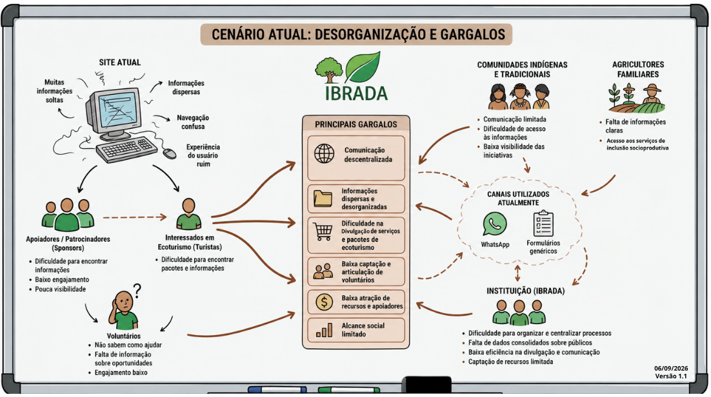
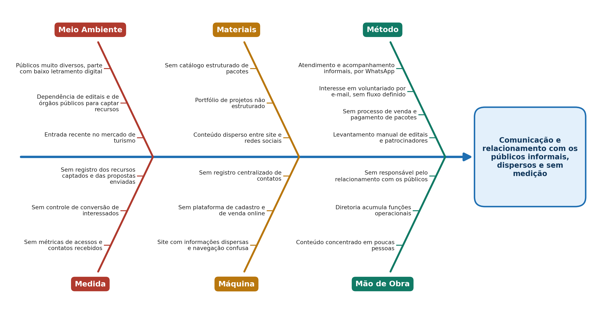
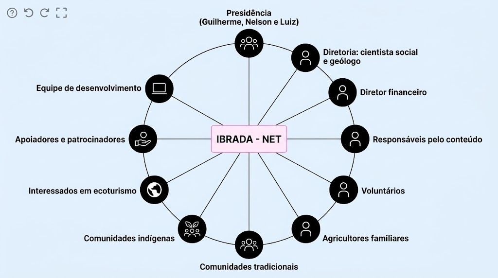

## Controle de versão

|Data|Versão|Descrição| Autor (es)|
|--|--|--|--|
|26/08/2026|0.01|Proposta inicial do produto.|Arthur, Zayra, Gabriel|
|30/08/2026|0.02|Ajustes da proposta|Cauã e Vinícius|
|05/09/2026|0.03|Características de Produto e Tecnologias a serem utilizadas|Zayra Moraes|
|06/09/2026|0.04|Inclusão da Intervenção Social e das Lições Aprendidas| Cauã Mendes|
|06/09/2026|0.05|Benefícios Esperados| Igor Lima|
|06/09/2026|0.06|Quadro Comparativo do 4.2 | Filipe Brito|
|06/09/2026|0.07|Requisitos e o Rad|Gabriel Guedes|
|06/09/2026|0.08|Composição da Equipe|Igor Lima|
|07/09/2026|0.09|Cronograma final|Zayra Moraes|
|07/09/2026|0.10|Inclusão do tópico Comunicação|Gabriel Guedes|
|07/09/2026|0.11|Inclusão do tópico Atividades e Técnicas de ER| Vinícius dos Santos|
|07/09/2026|0.12|Processo de Validação|Vinícius dos Santos|
|08/09/2026|1.0|Entrega unidade 1|Toda a equipe|
|20/09/2026|1.1|Ajuste no tópico Desafios do projeto e no quadro resumo dos stakeholders|Cauã|
|20/09/2026|1.2|Correções nos tópicos 2.6 e 2.4|Vinícius|
|21/09/2026|1.3|Ajustes do tópico 2.|Zayra|
|21/09/2026|1.4|Adição parcial dos requisitos.|Zayra|
|27/09/2026|1.5|Correção nos requisitos a partir da verificação em pares|Gabriel , Zayra, Vinicius, Arthur|
|28/09/2026|1.6|Entrega de atividade 4|Arthur, Vinicius, Filipe, Gabriel, Igor, Cauã e Zayra |
|03/10/2026|1.7|Ajustes no cronograma|Gabriel Guedes|
|04/10/2026|1.8|Ajustes no cronograma|Gabriel Guedes|
|06/10/2026|1.9|Correção do tópico 4 - quadro comparativo e justificativas |Filipe Brito|
|10/10/2026|1.10|Adição do glossário com siglas das atividades ER|Gabriel Guedes|
|11/10/2026|1.11|Adição de escopo e outros ajustes no cronograma|Gabriel Guedes|
|11/10/2026|1.12|Ajustes em Lições Aprendidas da Unidade 1|Gabriel Guedes|
|12/10/2026|1.13|Ajustes nas Regras de Negócio|Gabriel Guedes|
|12/10/2026|1.14|Correção da seção 5 de processo de ER|Vinicius|
|12/10/2026|1.15|Ajustes em Cenário Atual do Cliente e do Negócio da Unidade 1|Arthur Scartezini, Cauã Mendes|
|12/10/2026|1.16|Adição do glossário com siglas de rastreabilidade do backlog|Gabriel|
|12/10/2026|1.17|Adição do backlog|Zayra Moraes|
|12/10/2026|1.18|Adição das lições aprendidas da unidade 2|Arthur Scartezini, Gabriel Guedes|
|13/10/2026|2.0 |Entrega Unidade 2| Toda a equipe
|27/10/2026|2.1 |Ajuste tópico 8| Cauã

*Tabela 1: Tabela de versionamento*

## 1.1 Identificação do Cliente/Parceiro

- **Nome:** Instituto Brasileiro do Direito Ambiental - IBRADA
- **Tipo:** OSCIP (Organização da Sociedade Civil de Interesse Público)
- **Representante:** Guilherme Sampaio Scartezini, Nelson Vicente e Luiz Freitas Jr
- **Forma de contato:** Reuniões remotas via Google Teams
- **Vínculo com o projeto:** Cliente real e umas das partes interessadas principais, representa o stakeholder primordial (Presidência da instituição). Será um dos responsáveis por validar requisitos e decisões do projeto, além de avaliar as entregas realizadas ao longo do desenvolvimento.

## 1.2 Introdução ao Negócio e Contexto

O Instituto Brasileiro de Direito Ambiental - IBRADA é uma organização sem fins lucrativos que tem como missão promover a educação, a paz, a ética, a cidadania, o direito e a justiça em defesa da conservação e recuperação do meio ambiente. A dinâmica atual do instituto se concentra principalmente em oferecer consultoria e elaboração dos documentos necessários para a regularização ambiental e fundiária de propriedades rurais no DF, venda de pacotes de viagens ou trilhas que promovem o ecoturismo, e a inclusão socioprodutiva de comunidades carentes, com foco em soluções de agroecologia e turismo de base comunitária.

O público-alvo da organização se divide em duas frentes principais de interação:

- Beneficiários/Clientes: Inclui os interessados que pagam pelos pacotes de ecoturismo, as comunidades indígenas e tradicionais (beneficiários não pagantes da inclusão socioprodutiva) e os agricultores familiares (que participam da inclusão socioprodutiva e/ou pagam um valor simbólico pelos serviços de regularização de suas terras).
- Parceiros: Composto por voluntários que colaboram com o trabalho diário, além de apoiadores e patrocinadores responsáveis por injetar recursos financeiros, materiais e equipamentos.	

A estratégia da organização utiliza metodologias participativas para garantir o protagonismo local e adaptar tecnologias sociais e ambientais aos biomas brasileiros. Atualmente, o IBRADA possui um site que limita a instituição, não traz os resultados necessários de engajamento com voluntários, patrocinadores e apoiadores, e não recruta com eficiência os interessados em viagens e trilhas de ecoturismo, somado a isso, as informações se encontram dispersas pelas páginas e links no site, o que gera gargalos significativos. Essa dificuldade impacta a venda de serviços de ecoturismo e a captação de novos clientes para regularização fundiária.

## 1.3 Rich Picture

*Figura 1: Rich Picture. Elaborado por Arthur Scartezini. Modificado por Cauã Mendes e Zayra Moraes*

- **Atores:** Presidência e diretoria do IBRADA, interessados em ecoturismo, voluntários, apoiadores e patrocinadores, comunidades indígenas e tradicionais e agricultores familiares.
- **Fluxo problemático atual:** Os públicos conhecem o IBRADA pelo site e pelas redes sociais, onde as informações estão dispersas. Quem deseja ser voluntário envia um e-mail, pois a ONG não tem programa de voluntariado. No ecoturismo, a divulgação e o atendimento ocorrem de maneira informal, em dois grupos de WhatsApp com cerca de 1.000 trilheiros, e ainda não há venda de pacotes. Na regularização fundiária, o instituto elabora o Plano de Utilização (PU) para agricultores com lotes arrendados do GDF, onde o processo é burocrático e confuso. Já os apoiadores e patrocinadores dependem do levantamento de editais e de propostas apresentadas diretamente. Como resultado, o IBRADA não dispõe de dados consolidados sobre seus públicos.

## 1.4 Identificação da Oportunidade ou Problema

O IBRADA atua em diferentes frentes, como consultorias, ecoturismo, preservação ambiental e inclusão socioprodutiva. Entretanto, atualmente enfrenta dificuldades para centralizar e organizar a comunicação e o relacionamento com seus diferentes públicos. A atual infraestrutura digital não atende adequadamente às necessidades da organização, enquanto parte significativa da comunicação ocorre por meio de canais informais. Além disso, as informações sobre os serviços e projetos encontram-se dispersas, dificultando o acesso e a compreensão por parte dos interessados. 

Esse cenário reduz a capacidade do IBRADA de divulgar seus serviços, atrair novos clientes, captar voluntários e apoiadores, e ampliar o alcance de suas iniciativas. Dessa forma, o problema central identificado é: atualmente, alguém conhece um projeto somente pela divulgação no Instagram, e procura o IBRADA por meio do WhatsApp divulgado no site que já existe, entretanto a instituição não possui um canal digital centralizado que apresente seus projetos e serviços adequadamente, receba e acompanhe seus diferentes públicos e permita medir esse relacionamento. Com isso, o interesse desses públicos não se converte de forma organizada em ações concretas, como contratação de serviços, participação como voluntário e apoio aos projetos da instituição. Em relação aos voluntários, o IBRADA atualmente não possui nenhum voluntário, pois não existe um programa de voluntariado estruturado. Quem deseja colaborar envie um e-mail à instituição, sem triagem ou acompanhamento, o que torna a taxa de conversão e o número de desistências impossíveis de mensurar. Isso significa que a dificuldade não está em reter voluntários, mas na ausência de um fluxo para captá-los e acompanhá-los.

No ecoturismo, nenhum pacote foi vendido até o momento. As atividades realizadas no DF e no Pará foram trilhas voluntárias oferecidas pela direção, e somente no início de 2026 a atividade de Operadora de Turismo foi incluída no estatuto, o que passou a permitir a venda de pacotes. Não há registro do número de contatos recebidos nem de acessos ao site, o que impede avaliar a eficácia da divulgação.

Quanto à captação de recursos, a dificuldade não é de ineficiência comercial, mas de levantamento de editais exclusivos para ONGs e de patrocinadores aos quais apresentaram as propostas elaboradas em parceria com as comunidades beneficiárias. Portanto, a ausência de números também é um problema, pois atualmente o IBRADA não mede acessos, contatos, conversão e nem recursos captados.

A Figura a seguir, apresenta o diagrama de Ishikawa contendo as causas (organizados pelos 6M’s) e o problema do IBRADA:

*Figura 2: Diagrama de Ishikawa. Elaborado por Cauã Mendes (2026).*

##  1.5 Desafios do Projeto

Durante as entrevistas realizadas com representantes do IBRADA, foram identificados desafios relacionados principalmente à comunicação com os diferentes públicos da instituição e à organização das informações atualmente disponibilizadas.

O principal desafio está relacionado à experiência do usuário, uma vez que as informações sobre os serviços, projetos e formas de participação encontram-se distribuídas em diferentes páginas e canais de comunicação. Essa dispersão pode dificultar que um visitante compreenda rapidamente quais serviços são oferecidos e qual ação deve realizar para contratar um serviço, participar como voluntário ou apoiar um projeto.

Outro desafio consiste em centralizar diferentes funcionalidades em uma única plataforma, considerando que o IBRADA possui públicos com necessidades distintas, como turistas, voluntários, apoiadores, patrocinadores, agricultores familiares e comunidades tradicionais.

##  1.6 Mapa de Stakeholders 

O projeto envolve diferentes stakeholders, tanto internos quanto externos ao IBRADA, que possuem diferentes níveis de interesse, influência e participação na solução. Entre eles estão os responsáveis pela gestão e operação da instituição, os usuários e beneficiários de suas iniciativas, parceiros e apoiadores, além da equipe responsável pelo desenvolvimento e manutenção da plataforma.

O quadro a seguir apresenta os principais stakeholders identificados e suas respectivas características, enquanto a Figura 3 apresenta uma representação visual de suas relações com o projeto.

| Stakeholder | Relação com a solução | Interesse principal | Influência |
|:---:|:---:|:---:|:---:|
| Presidência (Guilherme, Nelson e Luiz) | Cliente real; valida requisitos e entregas. O presidente produz o conteúdo | Validar requisitos, decisões e avaliar as entregas realizadas ao longo do desenvolvimento | Alta |
| Diretoria: cientista social e geólogo | Responsáveis pelos pacotes e trilhas | Operar os pacotes de ecoturismo | Média |
| Diretor financeiro | Responsável pela parte financeira, junto com o presidente | Ter controle e registro das receitas dos pacotes e dos recursos captados | Média |
| Responsáveis pelo conteúdo (presidente e um estudante de Eng.Software) | O presidente produz o conteúdo e o estudante  atualiza | Manter o conteúdo organizado e atualizado | Média |
| Interessados em ecoturismo | Usuários finais pagantes dos pacotes e trilhas | Acessar informações de pacotes de ecoturismo e realizar compras com clareza e agilidade | Média |
| Comunidades indígenas | Beneficiários das iniciativas e serviços disponibilizados pelo IBRADA | Ter acesso facilitado, com menor burocracia, às informações de iniciativas sociais e serviços de regularização de terras | Média |
| Comunidades tradicionais | Beneficiários e participantes de iniciativas de inclusão socioprodutiva e turismo de base comunitária | Acessar informações sobre projetos, iniciativas e serviços oferecidos pelo IBRADA de forma clara e acessível | Média |
| Agricultores familiares | Beneficiários das iniciativas de inclusão socioprodutiva do IBRADA | Obter informações e acesso facilitado às iniciativas de inclusão socioprodutiva | Média |
| Apoiadores e patrocinadores | Parceiros que injetam recursos financeiros e materiais  | Encontrar informações de forma rápida para apoiar os projetos e aumentar a visibilidade de suas ações | Alta |
| Voluntários | Usuários que colaboram com a operação diária  | Encontrar informações claras sobre oportunidades de ajuda e engajar-se nos projetos facilmente | Média |
| Equipe de desenvolvimento | Responsável pela construção técnica do sistema | Unificar as funcionalidades para operar a solução digital como portal institucional seguro e acessível | Média |

*Tabela 2: Tabela de stakeholders*

*Figura 3:  Mapa de Stakeholders. Elaborado por Arthur Scartezini (2026).*

## 1.7 Segmentação de Clientes

Dentro do público-alvo do IBRADA temos perfis distintos com necessidades diferentes, entre eles:

* **Interessados em Ecoturismo:** Público pagante que busca adquirir pacotes de viagens ou trilhas que promovem o ecoturismo e experiências imersivas.
* **Comunidades Indígenas e Tradicionais:** Beneficiários diretos e não pagantes. O foco deste segmento é a integração de seus saberes ancestrais com os projetos do IBRADA, focados em agroecologia e preservação ambiental.
* **Voluntários, Patrocinadores e Apoiadores:** Voluntários para o projeto e investidores (pessoas físicas ou empresas) que fornecem recursos financeiros, materiais ou equipamentos. 
* **Agricultores familiares:** Beneficiários da inclusão sócio-produtiva.
