## Protótipos Iniciais

As primeiras representações visuais do produto foram desenvolvidas durante o ciclo do Incremento 1 e serviram de base para a estrutura visual e os fluxos do produto. As imagens a seguir foram exibidas ao cliente com o objetivo de validar os fluxos de operações; no entanto, devido à dificuldade de entendimento desses protótipos de baixa fidelidade, as validações foram realizadas com os protótipos de média fidelidade exibidos no [mapa de rastreabilidade](../planejamento/rastreabilidade.md#mapa-interativo), onde a estrutura visual do site e os fluxos de atividades são mais evidentes.

=== "EP05"

    

      

        

          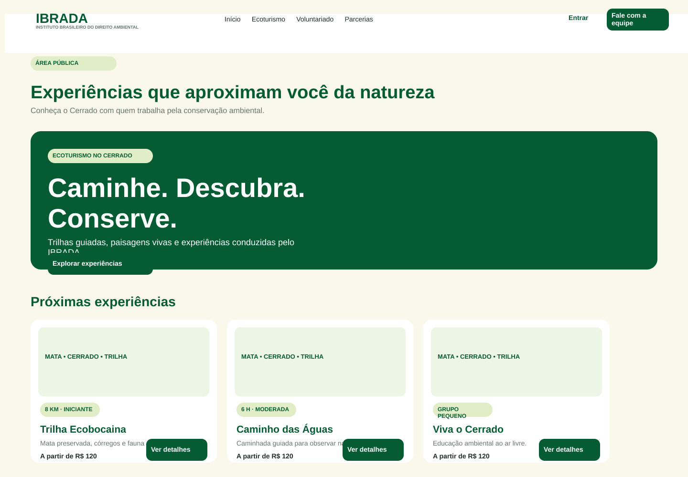
          
Tela 1 — Catálogo de Pacotes de Ecoturismo

        

        

          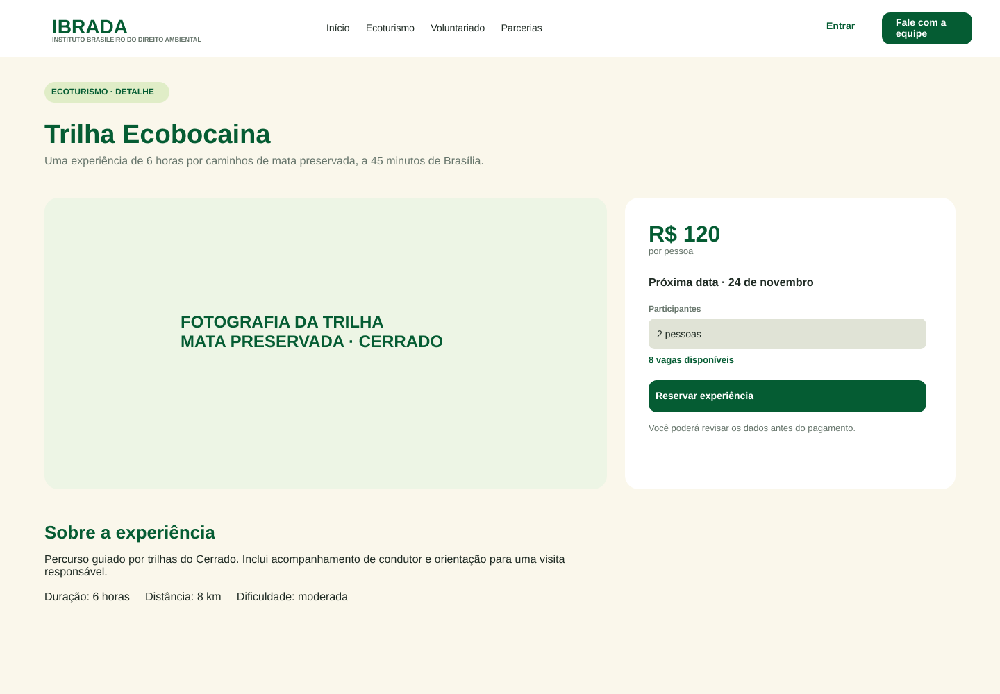
          
Tela 2 — Página do Pacote Selecionado

        

        

          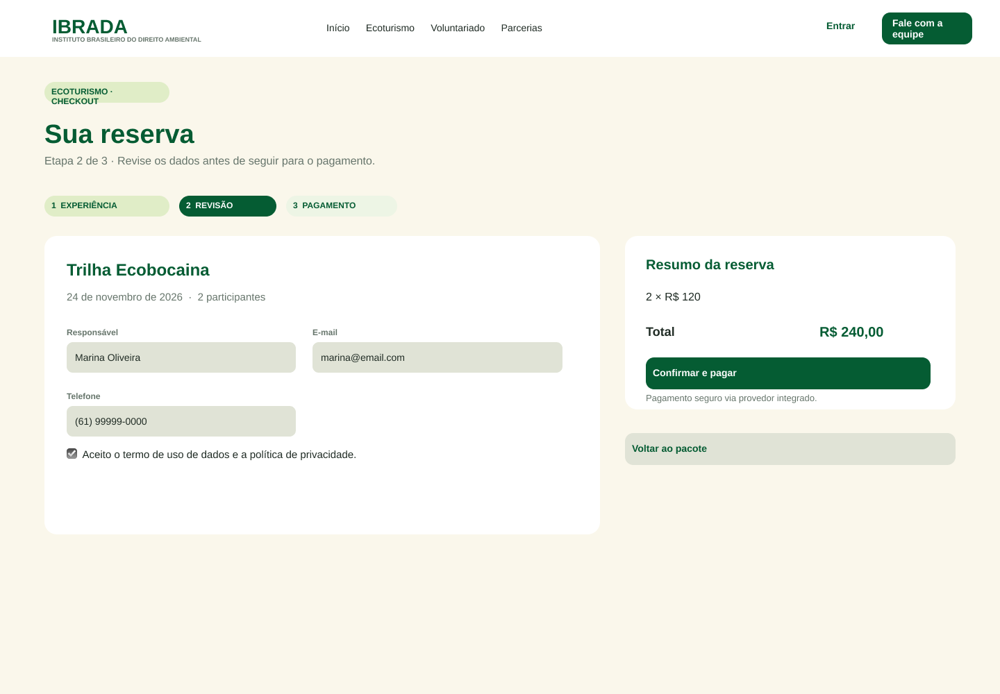
          
Tela 3 — Reserva e Pagamento do Pacote Selecionado

        

      

      

      

      

    

=== "EP07"

    

      

        

          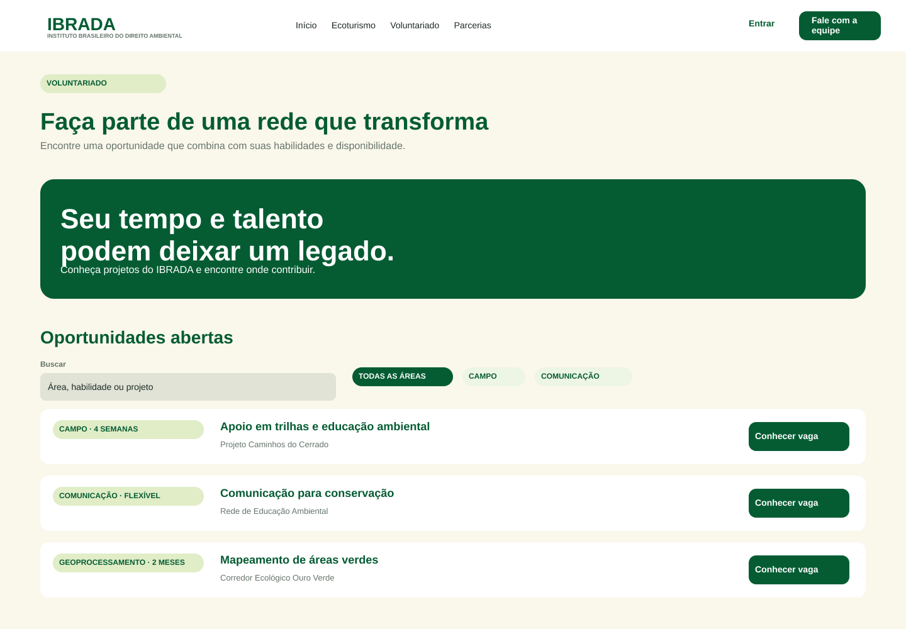
          
Tela 1 — Catálogo de Oportunidades

        

        

          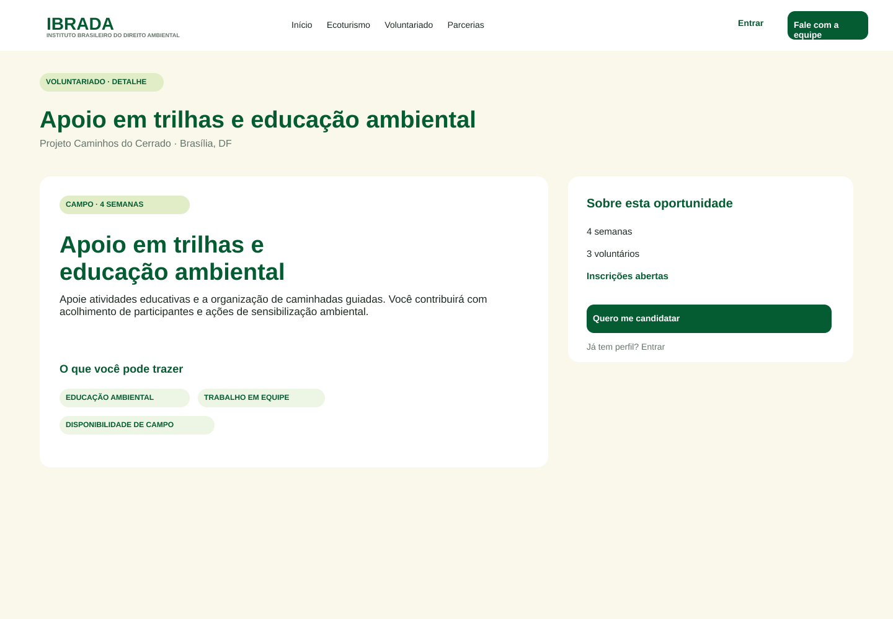
          
Tela 2 — Página da Oportunidade Selecionada

        

        

          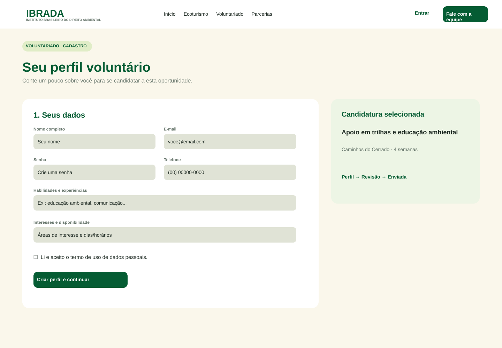
          
Tela 3 — Criação de Perfil do Voluntário

        

      

      

      

      

    

=== "EP08"

    

      

        

          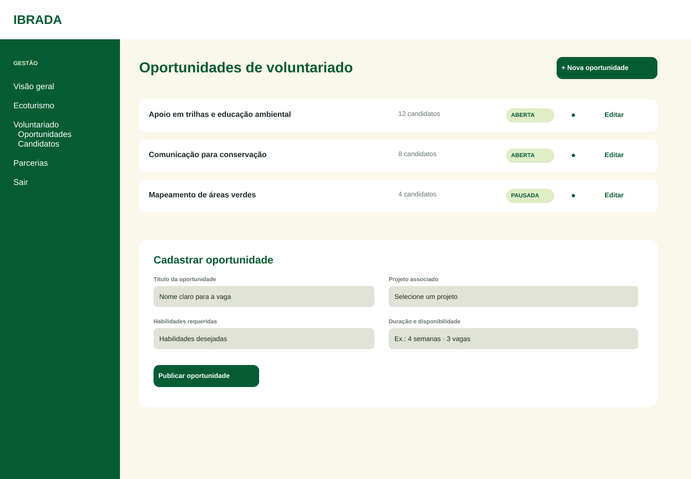
          
Tela 1 — Tela de Gestão: Oportunidades

        

        

          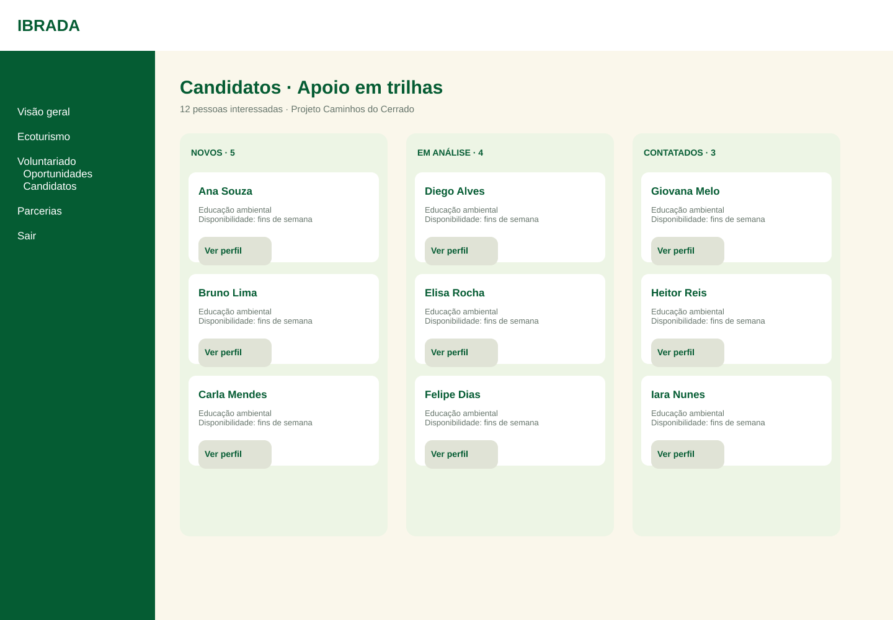
          
Tela 2 — Tela de Gestão: Candidatos

        

      

      

      

      

    

=== "EP09"

    

      

        

          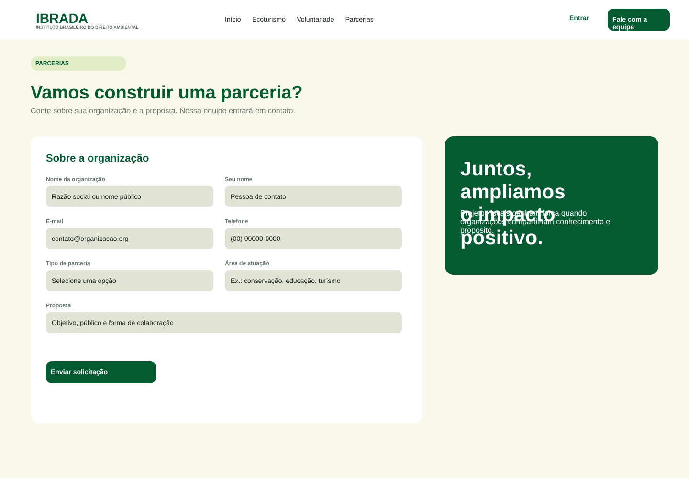
          
Tela 1 — Formulário para Parcerias

        

        

          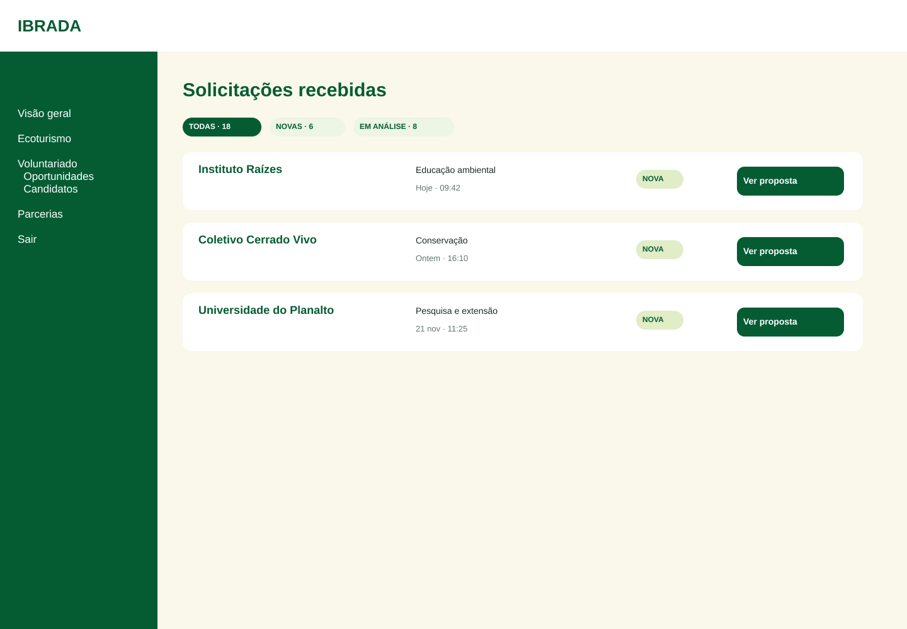
          
Tela 2 — Tela de Gestão: Parcerias Recebidas

        

        

          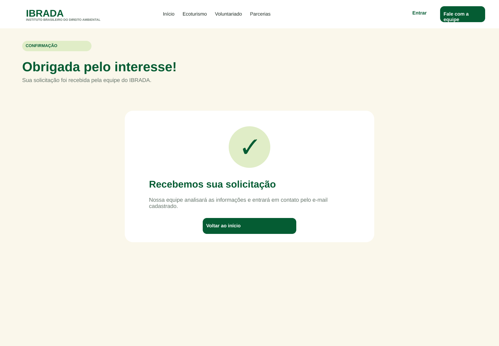
          
Tela 3 — Confirmação do Formulário

        

      

      

      

      

    

=== "Outros"

    

      

        

          
          
Tela 1 — Fluxos e Paleta do Produto

        

      

      

      

      

    

## Banco de Dados

O diagrama entidade-relacionamento abaixo representa a implementação atual do banco de dados, bem como as relações entre suas tabelas.

  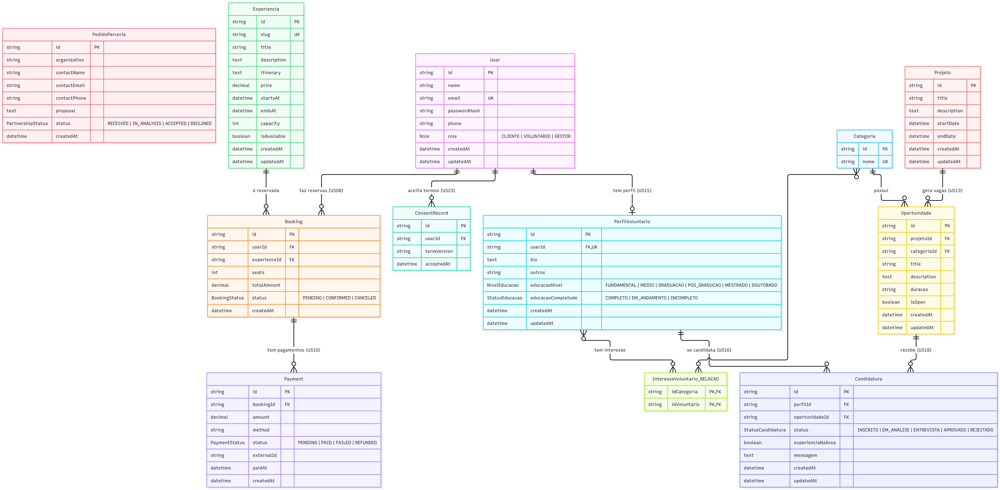

#### Resumo por tema

| Tema | Tabelas | User stories |
| --- | --- | --- |
| Conta e LGPD | `User`, `ConsentRecord` | US04–US07, US17, US22, US23 |
| Ecoturismo e reservas | `Experiencia`, `Booking`, `Payment` | US02, US03, US08–US12 |
| Voluntariado | `Projeto`, `Oportunidade`, `Candidatura`, `PerfilVoluntario`, `Categoria`, `InteresseVoluntario` | US13–US18, US21 |
| Parcerias | `PedidoParceria` | US19, US20 |

> `PedidoParceria` aparece sem linhas de relação de propósito: quem envia a solicitação é visitante, sem conta (US19).
> `Candidatura` tem restrição única em (`perfilId`, `oportunidadeId`): ninguém se candidata duas vezes à mesma vaga.
> A relação muitos-para-muitos com `Categoria` e `PerfilVoluntario` usa a tabela de junção explícita `InteresseVoluntario`, com chave composta. Assim o vínculo pode ganhar campos no futuro.