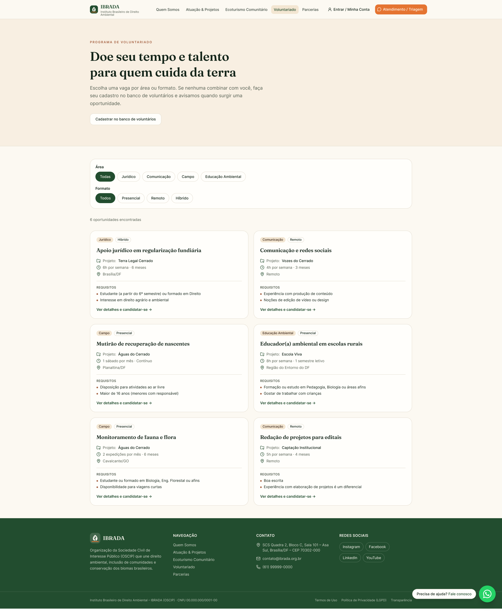
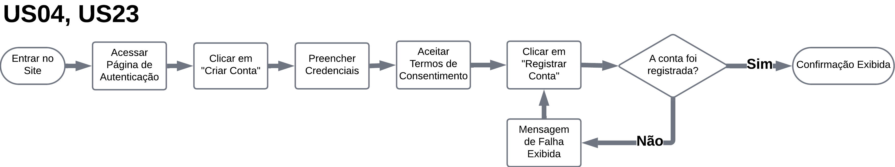
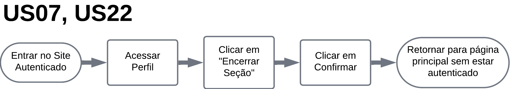
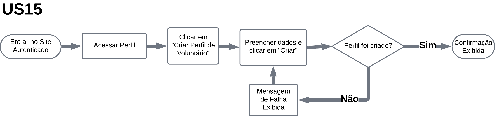
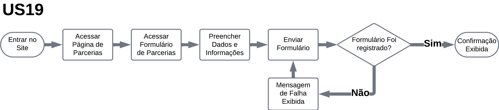

# Protótipos de Média/Alta Fidelidade

> Os protótipos foram desenvolvidos para auxiliar na representação do fluxo e do aspecto visual do produto. O conteúdo apresentado nas imagens pode não refletir a versão final planejada.

=== "EP03 & EP05"

    

      

        

          
          
US04 e US23

        

        

          
          
US05

        

        

          
          
US06 e US17

        

        

          
          
US07 e US22

        

        

          
          
US15

        

      

      

      

      

    

=== "EP07"

    

      

        

          
          
US14

        

        

          
          
US21

        

      

      

      

      

    

=== "EP09"

    

      

        

          
          
US19

        

      

      

      

      

    

# Diagramas de Atividade

> Alguns diagramas representam mais de uma história de usuário. Nestes casos, as histórias complementam ou representam o mesmo fluxo de atividades.

=== "EP03 & EP05"

    

      

        

          
          
US04 e US23

        

        

          
          
US05

        

        

          
          
US06 e US17

        

        

          
          
US07 e US22

        

        

          
          
US15

        

      

      

      

      

    

=== "EP07"

    

      

        

          
          
US14 e US21

        

      

      

      

      

    

=== "EP09"

    

      

        

          
          
US19

        

        

          
          
US20

        

      

      

      

      

    

# Definition of Done

| Critério do DoD | Evidências | Status |
| --------------- | ---------- | ------ |
| O código foi devidamente revisado e integrado? | [PR #57](https://github.com/mdsreq-fga-unb/REQ-2026.2-T01-IBRADA-NET/pull/57), [PR #70](https://github.com/mdsreq-fga-unb/REQ-2026.2-T01-IBRADA-NET/pull/70), [PR #72](https://github.com/mdsreq-fga-unb/REQ-2026.2-T01-IBRADA-NET/pull/72), [PR #75](https://github.com/mdsreq-fga-unb/REQ-2026.2-T01-IBRADA-NET/pull/75), [PR #76](https://github.com/mdsreq-fga-unb/REQ-2026.2-T01-IBRADA-NET/pull/76), [PR #80](https://github.com/mdsreq-fga-unb/REQ-2026.2-T01-IBRADA-NET/pull/80), [PR #81](https://github.com/mdsreq-fga-unb/REQ-2026.2-T01-IBRADA-NET/pull/81), [PR #82](https://github.com/mdsreq-fga-unb/REQ-2026.2-T01-IBRADA-NET/pull/82), [PR #85](https://github.com/mdsreq-fga-unb/REQ-2026.2-T01-IBRADA-NET/pull/85) | Concluído 🆗 |
| A funcionalidade atende às regras de negócio e critérios de aceitação? | [Issue #37](https://github.com/mdsreq-fga-unb/REQ-2026.2-T01-IBRADA-NET/issues/37), [Issue #38](https://github.com/mdsreq-fga-unb/REQ-2026.2-T01-IBRADA-NET/issues/38), [Issue #39](https://github.com/mdsreq-fga-unb/REQ-2026.2-T01-IBRADA-NET/issues/39), [Issue #40](https://github.com/mdsreq-fga-unb/REQ-2026.2-T01-IBRADA-NET/issues/40), [Issue #41](https://github.com/mdsreq-fga-unb/REQ-2026.2-T01-IBRADA-NET/issues/41), [Issue #42](https://github.com/mdsreq-fga-unb/REQ-2026.2-T01-IBRADA-NET/issues/42), [Issue #43](https://github.com/mdsreq-fga-unb/REQ-2026.2-T01-IBRADA-NET/issues/43), [Issue #44](https://github.com/mdsreq-fga-unb/REQ-2026.2-T01-IBRADA-NET/issues/44), [Issue #45](https://github.com/mdsreq-fga-unb/REQ-2026.2-T01-IBRADA-NET/issues/45), [Issue #46](https://github.com/mdsreq-fga-unb/REQ-2026.2-T01-IBRADA-NET/issues/46), [Issue #47](https://github.com/mdsreq-fga-unb/REQ-2026.2-T01-IBRADA-NET/issues/47), [Issue #48](https://github.com/mdsreq-fga-unb/REQ-2026.2-T01-IBRADA-NET/issues/48) | Concluído 🆗 |
| Os Requisitos Não Funcionais (RNFs) aplicáveis foram atendidos? | [PR #57](https://github.com/mdsreq-fga-unb/REQ-2026.2-T01-IBRADA-NET/pull/57), [PR #70](https://github.com/mdsreq-fga-unb/REQ-2026.2-T01-IBRADA-NET/pull/70), [PR #72](https://github.com/mdsreq-fga-unb/REQ-2026.2-T01-IBRADA-NET/pull/72), [PR #75](https://github.com/mdsreq-fga-unb/REQ-2026.2-T01-IBRADA-NET/pull/75), [PR #76](https://github.com/mdsreq-fga-unb/REQ-2026.2-T01-IBRADA-NET/pull/76), [PR #80](https://github.com/mdsreq-fga-unb/REQ-2026.2-T01-IBRADA-NET/pull/80), [PR #81](https://github.com/mdsreq-fga-unb/REQ-2026.2-T01-IBRADA-NET/pull/81), [PR #82](https://github.com/mdsreq-fga-unb/REQ-2026.2-T01-IBRADA-NET/pull/82), [PR #85](https://github.com/mdsreq-fga-unb/REQ-2026.2-T01-IBRADA-NET/pull/85) | Concluído 🆗 |
| Os testes foram executados com sucesso (ou com exceção devidamente registrada)? | [PR #57](https://github.com/mdsreq-fga-unb/REQ-2026.2-T01-IBRADA-NET/pull/57), [PR #72](https://github.com/mdsreq-fga-unb/REQ-2026.2-T01-IBRADA-NET/pull/72), [PR #75](https://github.com/mdsreq-fga-unb/REQ-2026.2-T01-IBRADA-NET/pull/75), [PR #80](https://github.com/mdsreq-fga-unb/REQ-2026.2-T01-IBRADA-NET/pull/80), [PR #81](https://github.com/mdsreq-fga-unb/REQ-2026.2-T01-IBRADA-NET/pull/81), [PR #82](https://github.com/mdsreq-fga-unb/REQ-2026.2-T01-IBRADA-NET/pull/82), [PR #85](https://github.com/mdsreq-fga-unb/REQ-2026.2-T01-IBRADA-NET/pull/85) | Concluído 🆗 |
| A entrega passou pelas etapas de verificação, demonstração e aceite? | [Ata da reunião 15/11](https://mdsreq-fga-unb.github.io/REQ-2026.2-T01-IBRADA-NET/atas-reuniao/unidade-3/15-11/) | Em andamento 🔄 |
| A documentação foi atualizada? | O [Catálogo](https://mdsreq-fga-unb.github.io/REQ-2026.2-T01-IBRADA-NET/planejamento/rastreabilidade/#mapa-interativo) é atualizado automaticamente conforme as marcações das caixinhas de checklist dos critérios de aceitação das issues | Concluído 🆗 |