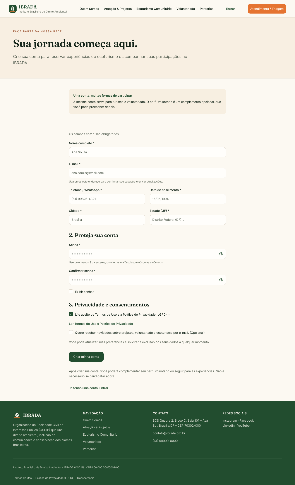
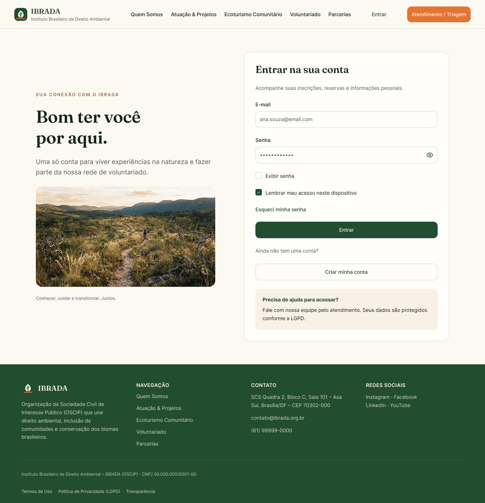
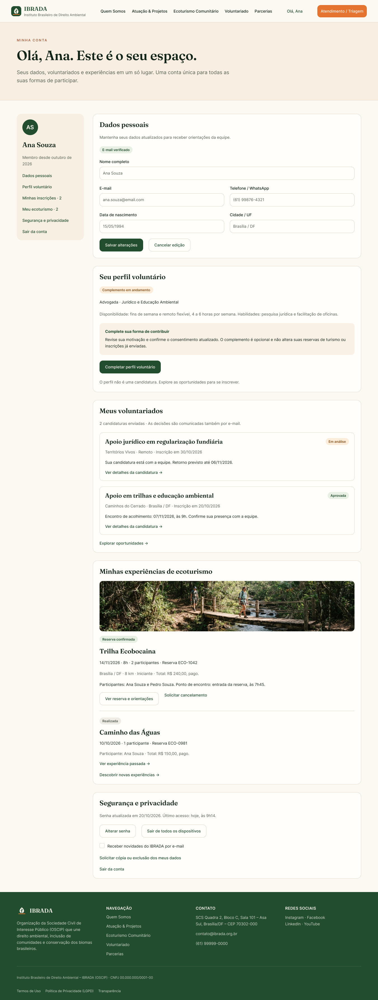
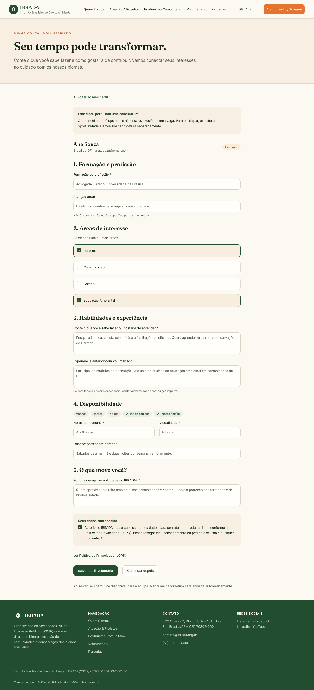
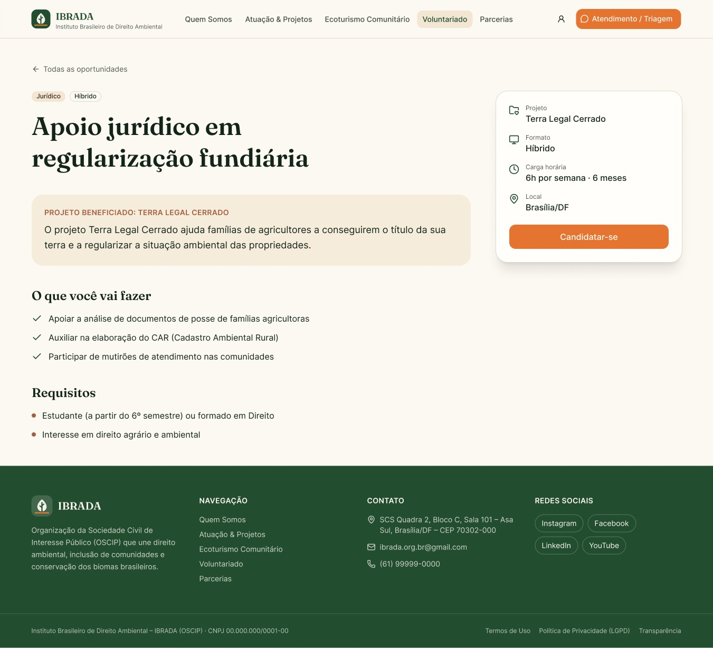
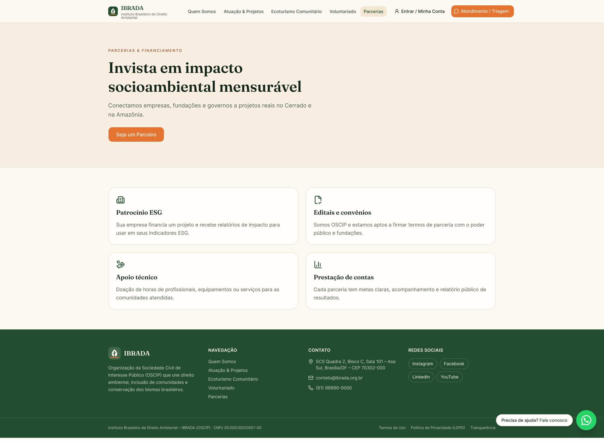
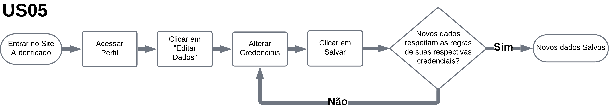
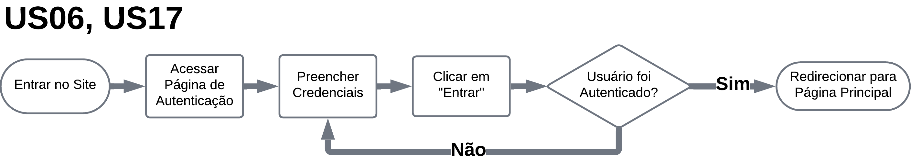
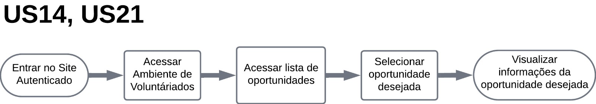
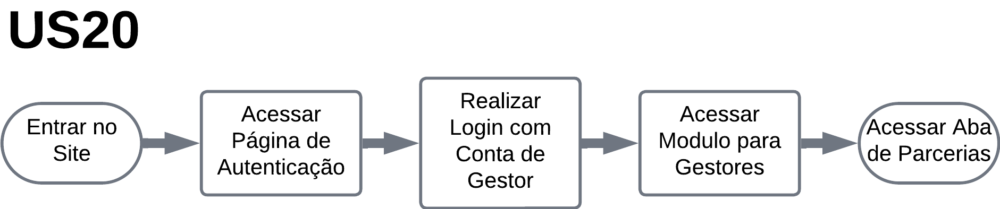

# Protótipos de Média/Alta Fidelidade

> Os protótipos foram desenvolvidos para auxiliar na representação do fluxo e do aspecto visual do produto. O conteúdo apresentado nas imagens pode não refletir a versão final planejada.

=== "EP03 & EP05"

    

      

        

          
          
US04 e US23

        

        

          
          
US05

        

        

          
          
US06 e US17

        

        

          
          
US07 e US22

        

        

          
          
US15

        

      

      

      

      

    

=== "EP07"

    

      

        

          
          
US14

        

        

          
          
US21

        

      

      

      

      

    

=== "EP09"

    

      

        

          
          
US19

        

      

      

      

      

    

# Diagramas de Atividade

=== "EP03 & EP05"

    

      

        

          
          
US04 e US23

        

        

          
          
US05

        

        

          
          
US06 e US17

        

        

          
          
US07 e US22

        

        

          
          
US15

        

      

      

      

      

    

=== "EP07"

    

      

        

          
          
US14 e US21

        

      

      

      

      

    

=== "EP09"

    

      

        

          
          
US19

        

        

          
          
US20

        

      

      

      

      

    
