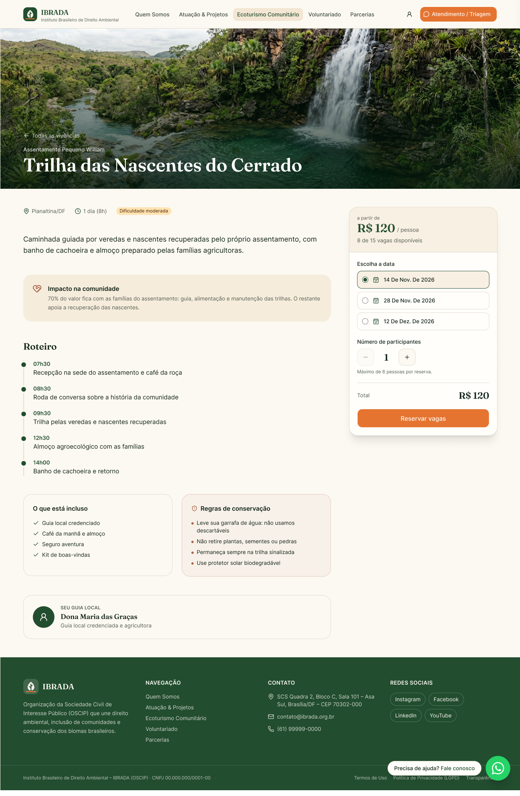
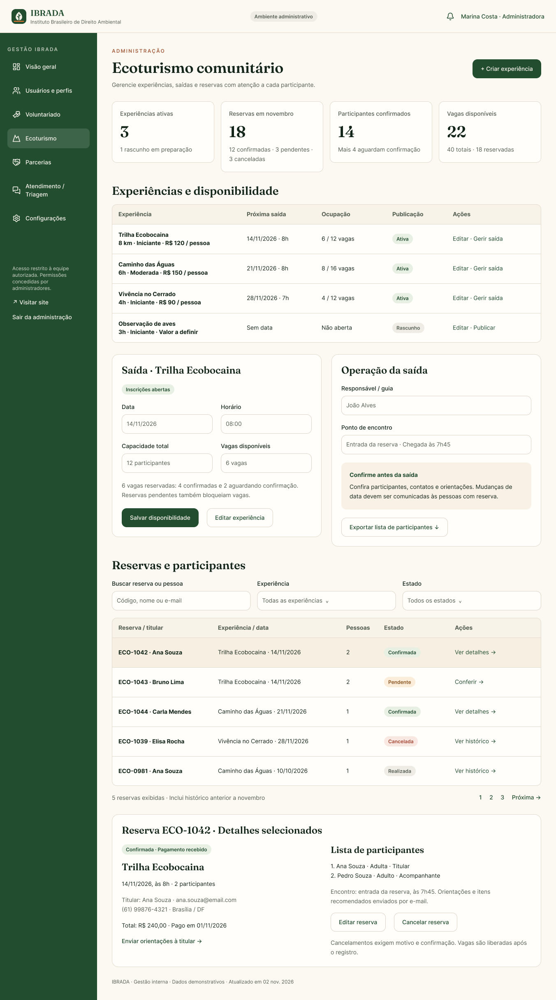
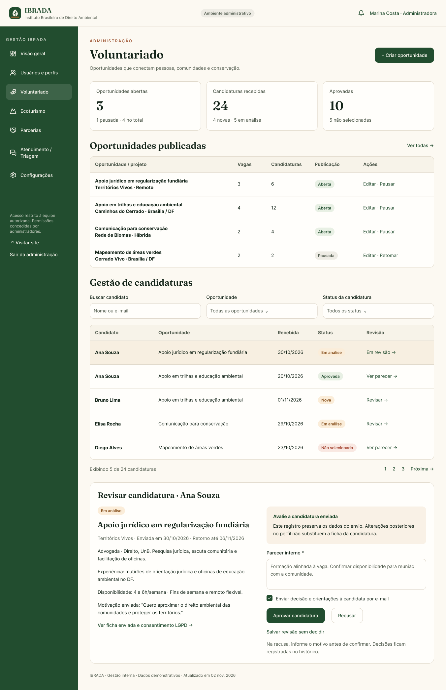
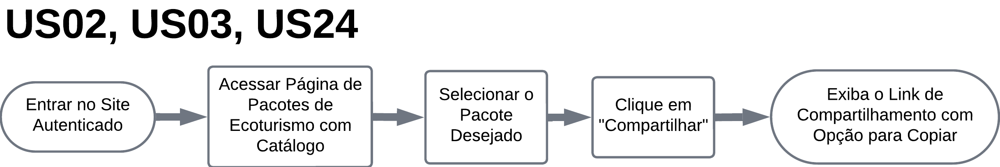
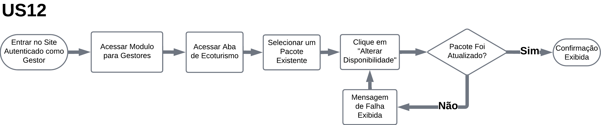
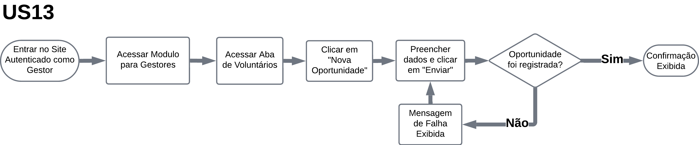
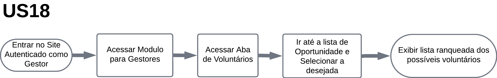

# Protótipos de Média/Alta Fidelidade

> Os protótipos foram desenvolvidos para auxiliar na representação do fluxo e do aspecto visual do produto. O conteúdo apresentado nas imagens pode não refletir a versão final planejada.

=== "EP02"

    

      

        

          
          
US02

        

        

          
          
US03

        

      

      

      

      

    

=== "EP05"

    

      

        

          
          
US11 e US12

        

      

      

      

      

    

=== "EP08"

    

      

        

          
          
US18 e US13

        

      

      

      

      

    

# Diagramas de Atividade

=== "EP02"

    

      

        

          
          
US02, US03 e US24

        

      

      

      

      

    

=== "EP05"

    

      

        

          
          
US11

        

        

          
          
US12

        

      

      

      

      

    

=== "EP08"

    

      

        

          
          
US13

        

        

          
          
US18

        

      

      

      

      

    
