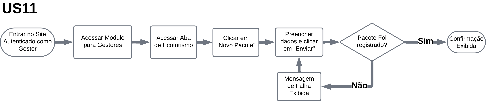

# Protótipos de Média/Alta Fidelidade

> Os protótipos foram desenvolvidos para auxiliar na representação do fluxo e do aspecto visual do produto. O conteúdo apresentado nas imagens pode não refletir a versão final planejada.

=== "EP02"

    

      

        

          
          
US02

        

        

          
          
US03

        

      

      

      

      

    

=== "EP05"

    

      

        

          
          
US11 e US12

        

      

      

      

      

    

=== "EP08"

    

      

        

          
          
US18 e US13

        

      

      

      

      

    

# Diagramas de Atividade

> Alguns diagramas representam mais de uma história de usuário. Nestes casos, as histórias complementam ou representam o mesmo fluxo de atividades.

=== "EP02"

    

      

        

          
          
US02, US03 e US24

        

      

      

      

      

    

=== "EP05"

    

      

        

          
          
US11

        

        

          
          
US12

        

      

      

      

      

    

=== "EP08"

    

      

        

          
          
US13

        

        

          
          
US18

        

      

      

      

      

    

# Definition of Done

| Critério do DoD | Evidências | Status |
| --------------- | ---------- | ------ |
| O código foi devidamente revisado e integrado? | [PR #79](https://github.com/mdsreq-fga-unb/REQ-2026.2-T01-IBRADA-NET/pull/79), [PR #82](https://github.com/mdsreq-fga-unb/REQ-2026.2-T01-IBRADA-NET/pull/82), [PR #85](https://github.com/mdsreq-fga-unb/REQ-2026.2-T01-IBRADA-NET/pull/85), [PR #87](https://github.com/mdsreq-fga-unb/REQ-2026.2-T01-IBRADA-NET/pull/87) | Em Andamento 🔄 |
| A funcionalidade atende às regras de negócio e critérios de aceitação? | [Issue #59](https://github.com/mdsreq-fga-unb/REQ-2026.2-T01-IBRADA-NET/issues/59), [Issue #60](https://github.com/mdsreq-fga-unb/REQ-2026.2-T01-IBRADA-NET/issues/60), [Issue #64](https://github.com/mdsreq-fga-unb/REQ-2026.2-T01-IBRADA-NET/issues/64), [Issue #65](https://github.com/mdsreq-fga-unb/REQ-2026.2-T01-IBRADA-NET/issues/65), [Issue #66](https://github.com/mdsreq-fga-unb/REQ-2026.2-T01-IBRADA-NET/issues/66), [Issue #68](https://github.com/mdsreq-fga-unb/REQ-2026.2-T01-IBRADA-NET/issues/68), [Issue #69](https://github.com/mdsreq-fga-unb/REQ-2026.2-T01-IBRADA-NET/issues/69), [Issue #67](https://github.com/mdsreq-fga-unb/REQ-2026.2-T01-IBRADA-NET/issues/67) | Em Andamento 🔄 |
| Os Requisitos Não Funcionais (RNFs) aplicáveis foram atendidos? | [PR #79](https://github.com/mdsreq-fga-unb/REQ-2026.2-T01-IBRADA-NET/pull/79), [PR #82](https://github.com/mdsreq-fga-unb/REQ-2026.2-T01-IBRADA-NET/pull/82), [PR #85](https://github.com/mdsreq-fga-unb/REQ-2026.2-T01-IBRADA-NET/pull/85), [PR #87](https://github.com/mdsreq-fga-unb/REQ-2026.2-T01-IBRADA-NET/pull/87) | Em Andamento 🔄 |
| Os testes foram executados com sucesso (ou com exceção devidamente registrada)? | [PR #79](https://github.com/mdsreq-fga-unb/REQ-2026.2-T01-IBRADA-NET/pull/79), [PR #82](https://github.com/mdsreq-fga-unb/REQ-2026.2-T01-IBRADA-NET/pull/82), [PR #85](https://github.com/mdsreq-fga-unb/REQ-2026.2-T01-IBRADA-NET/pull/85), [PR #87](https://github.com/mdsreq-fga-unb/REQ-2026.2-T01-IBRADA-NET/pull/87) | Em Andamento 🔄 |
| A entrega passou pelas etapas de verificação, demonstração e aceite? | [Ata da reunião 15/11](https://mdsreq-fga-unb.github.io/REQ-2026.2-T01-IBRADA-NET/atas-reuniao/unidade-3/15-11/) | Em Andamento 🔄 |
| A documentação foi atualizada? | O [Catálogo](https://mdsreq-fga-unb.github.io/REQ-2026.2-T01-IBRADA-NET/planejamento/rastreabilidade/#mapa-interativo) é atualizado automaticamente conforme as marcações das caixinhas de checklist dos critérios de aceitação das issues | Em Andamento 🔄 |