## Protótipos

Explicação.

=== "CP3"

    

      

        

          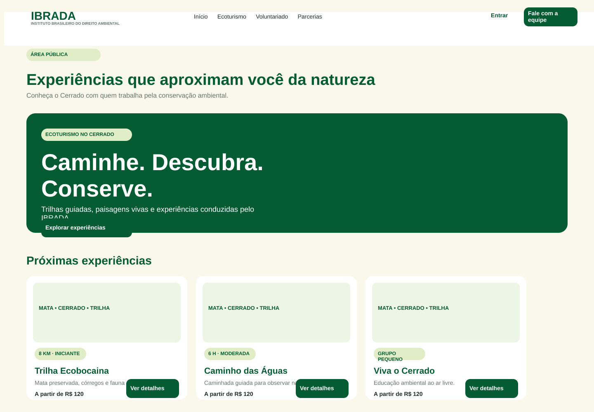
          
Tela 1 — Catálogo de Pacotes de Ecoturismo

        

        

          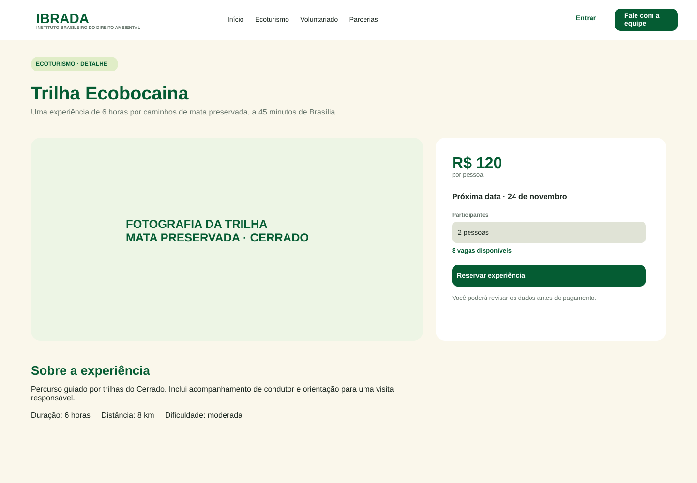
          
Tela 2 — Página do Pacote Selecionado

        

        

          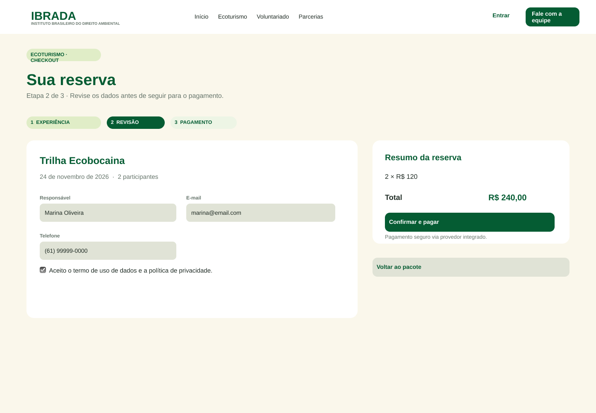
          
Tela 3 — Reserva e Pagamento do Pacote Selecionado

        

      

      

      

      

    

=== "CP4"

    

      

        

          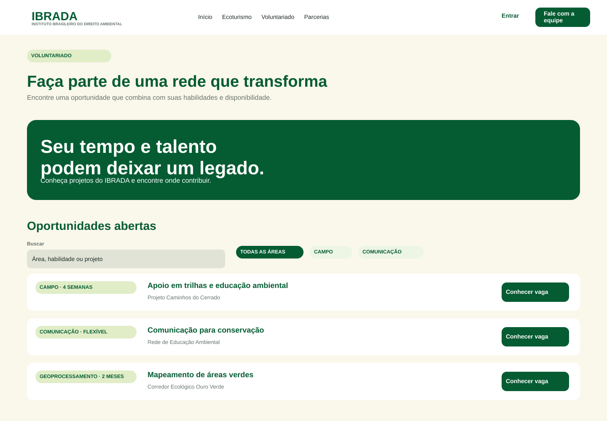
          
Tela 1 — Catálogo de Oportunidades

        

        

          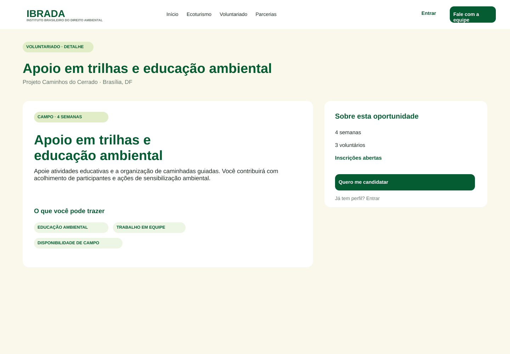
          
Tela 2 — Página da Oportunidade Selecionada

        

        

          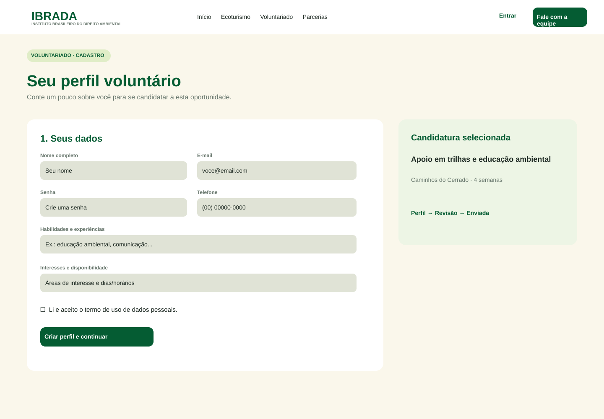
          
Tela 3 — Criação de Perfil do Voluntário

        

        

          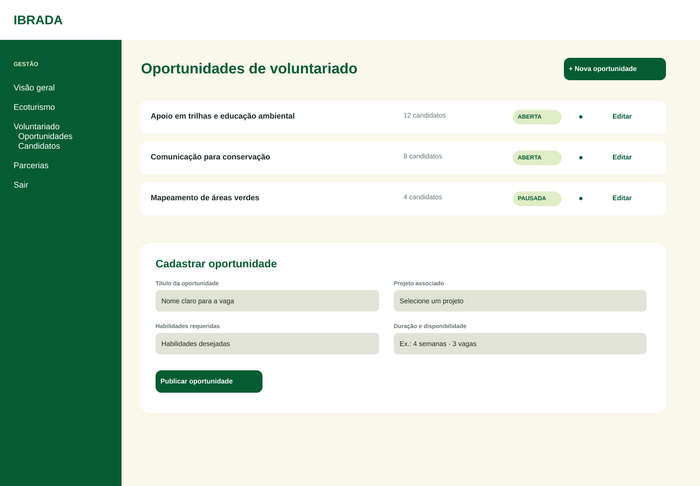
          
Tela 4 — Tela de Gestão: Oportunidades

        

        

          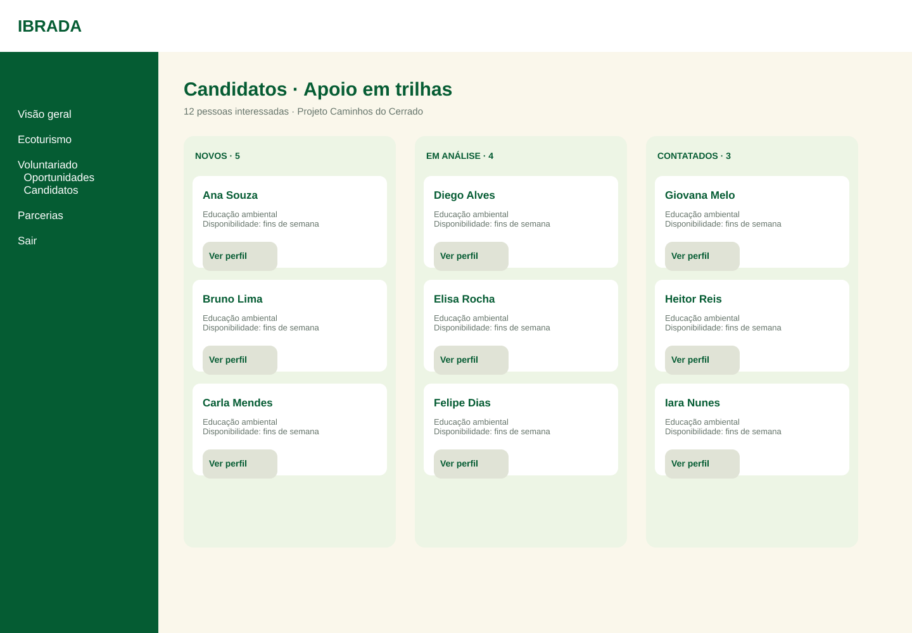
          
Tela 5 — Tela de Gestão: Candidatos

        

      

      

      

      

    

=== "CP6"

    

      

        

          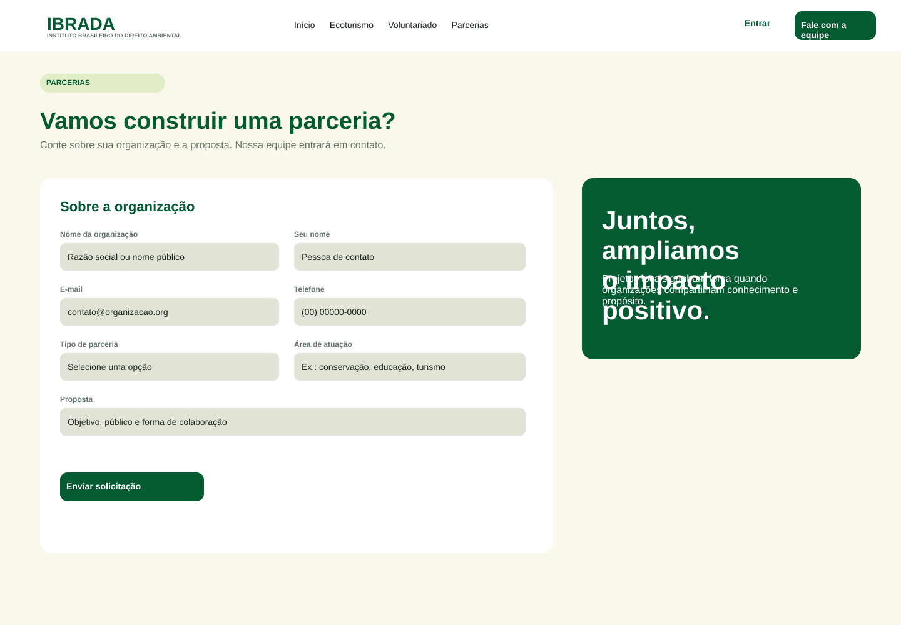
          
Tela 1 — Formulário para Parcerias

        

        

          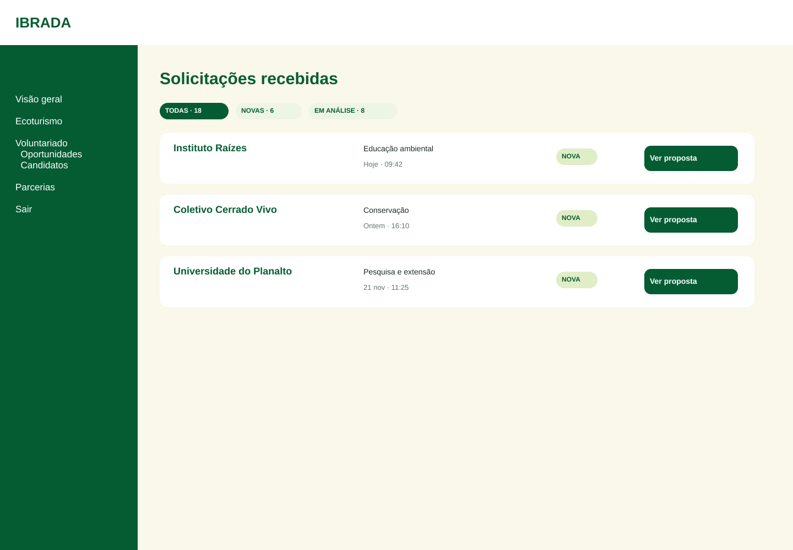
          
Tela 2 — Tela de Gestão: Parcerias Recebidas

        

        

          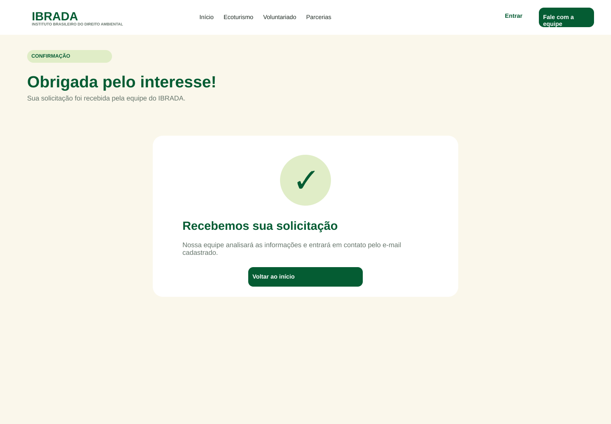
          
Tela 3 — Confirmação do Formulário

        

      

      

      

      

    

=== "Outros"

    

      

        

          
          
Tela 1 — Fluxos e Paleta do Produto

        

      

      

      

      

    

## Diagramas

### Banco de Dados

  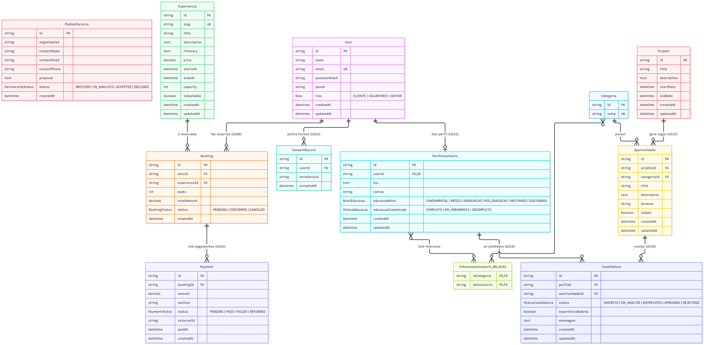

> `PedidoParceria` aparece sem linhas de relação de propósito: quem envia a solicitação é visitante, sem conta (US19).
> `Candidatura` tem restrição única em (`perfilId`, `oportunidadeId`): ninguém se candidata duas vezes à mesma vaga.
> A relação muitos-para-muitos com `Categoria` e `PerfilVoluntario` usa a tabela de junção explícitas `InteresseVoluntario`, com chave composta. Assim o vínculo pode ganhar campos no futuro.