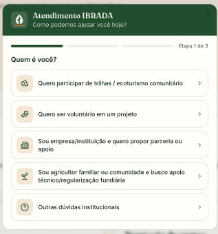

# US01 — Realizar triagem

!!! success "Dentro do MVP"
    Esta história faz parte do escopo definido para o MVP.

## Rastreabilidade

| Vínculo | Item |
| --- | --- |
| Requisito funcional | [RF05](../documento-visao/8_requisitos.md#rf05) — Apresentar formulário de triagem |
| Épico | [EP01](../planejamento/rastreabilidade.md#ep01) — Triagem e direcionamento |
| Tema | [T01](../planejamento/rastreabilidade.md#t01) — Atendimento e Triagem |
| Característica de produto | [CP2](../documento-visao/2_solucao.md#cp2) — Canal Unificado de Atendimento e Triagem |
| Objetivo específico | [OE1](../documento-visao/2_solucao.md#oe1) |
| Ciclo Planejado | Ciclo ? (Incremento ?) |
| Maturidade | Preparada para Construção?? (DoR atendida?) |
| Regras de negócio | [RN01](../documento-visao/8_requisitos.md#rn01), [RN02](../documento-visao/8_requisitos.md#rn02) |
| Requisitos não funcionais | [RNF01](../documento-visao/8_requisitos.md#rnf01), [RNF07](../documento-visao/8_requisitos.md#rnf07), [RNF09](../documento-visao/8_requisitos.md#rnf09) |

## História de usuário

> Como visitante da plataforma, quero responder a um formulário de triagem guiado e simplificado, para ser encaminhado ao setor ou fluxo de comunicação adequado à minha necessidade.

## Critérios de aceitação

- [ ] O sistema deve apresentar um formulário de triagem guiado, com campos simplificados, que possa ser concluído sem cadastro.
- [ ] O sistema deve identificar o tipo de solicitação e o perfil do visitante a partir das respostas e armazenar os dados informados.
- [ ] Após o envio, o sistema deve encaminhar o visitante ao canal ou departamento correspondente às respostas fornecidas.
- [ ] O sistema deve retornar uma mensagem de erro caso a triagem não possa ser concluída ou algum campo obrigatório não seja preenchido.

*Critérios escritos no formato das issues; esta história ainda não possui issue própria.*

## Protótipo

<!-- Inserir aqui a captura do protótipo, por exemplo:  -->

[link figma](https://www.figma.com/design/SU7j4U8GF1JhTSURf4a8Tf/Ibrada---net?node-id=0-1&t=9RMd3X9dpPFAitxH-1)
*Espaço reservado para a captura da prototipação desta história.*

## DoR e DoD

A verificação segue a [Definition of Ready](../documento-visao/9_dor_dod.md#91-definition-of-ready-dor) e a [Definition of Done](../documento-visao/9_dor_dod.md#92-definition-of-done-dod) do projeto.

- [ ] DoR