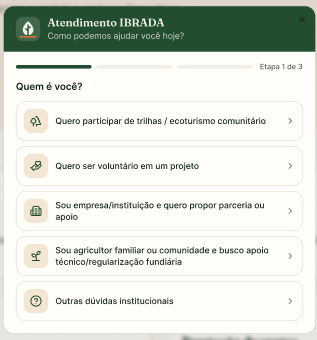
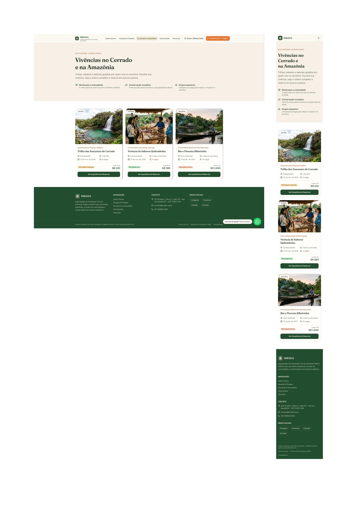

# US02 — Visualizar catálogo de ecoturismo

!!! success "Dentro do MVP"
    Esta história faz parte do escopo definido para o MVP.

## Rastreabilidade

| Vínculo | Item |
| --- | --- |
| Requisito funcional | [RF06](../documento-visao/8_requisitos.md#rf06) — Visualizar catálogo de ecoturismo |
| Épico | [EP02](../planejamento/rastreabilidade.md#ep02) — Descoberta de experiências e pacotes |
| Tema | [T02](../planejamento/rastreabilidade.md#t02) — Ecoturismo e Reservas |
| Característica de produto | [CP3](../documento-visao/2_solucao.md#cp3) — Módulo Transacional de Ecoturismo |
| Objetivo específico | [OE2](../documento-visao/2_solucao.md#oe2) |
| Ciclo Planejado | Ciclo ? (Incremento ?) |
| Maturidade | Preparada para Construção?? (DoR atendida?) |
| Dependências | [US11](us11.md), [US12](us12.md) (Pacotes cadastrados e disponíveis), [RNF01](../documento-visao/8_requisitos.md#rnf01), [RNF03](../documento-visao/8_requisitos.md#rnf03), [RNF07](../documento-visao/8_requisitos.md#rnf07) |

## História de usuário

> Como visitante, quero visualizar o catálogo de pacotes de ecoturismo, para conhecer as opções disponíveis e escolher a mais adequada ao meu interesse e planejamento.

## Critérios de aceitação

- [ ] O sistema deve exibir uma lista das experiências de ecoturismo com imagem de destaque, nome, descrição, data, vagas disponíveis e valor por pessoa.
- [ ] Experiências sem vagas ou indisponíveis devem ser sinalizadas na listagem, desabilitando o clique para compra.
- [ ] O catálogo deve carregar em até 3 segundos em condições normais de conexão (RNF03).
- [ ] O sistema deve permitir que o usuário selecione uma experiência e direcione para sua própria página de detalhes.

*Critérios escritos no formato das issues; esta história ainda não possui issue própria.*

## Protótipo

<!-- Inserir aqui a captura do protótipo, por exemplo:  -->

[link figma](https://www.figma.com/design/SU7j4U8GF1JhTSURf4a8Tf/Ibrada---net?node-id=0-1&t=9RMd3X9dpPFAitxH-1)
*Espaço reservado para a captura da prototipação desta história.*

## DoR e DoD

A verificação segue a [Definition of Ready](../documento-visao/9_dor_dod.md#91-definition-of-ready-dor) e a [Definition of Done](../documento-visao/9_dor_dod.md#92-definition-of-done-dod) do projeto.
