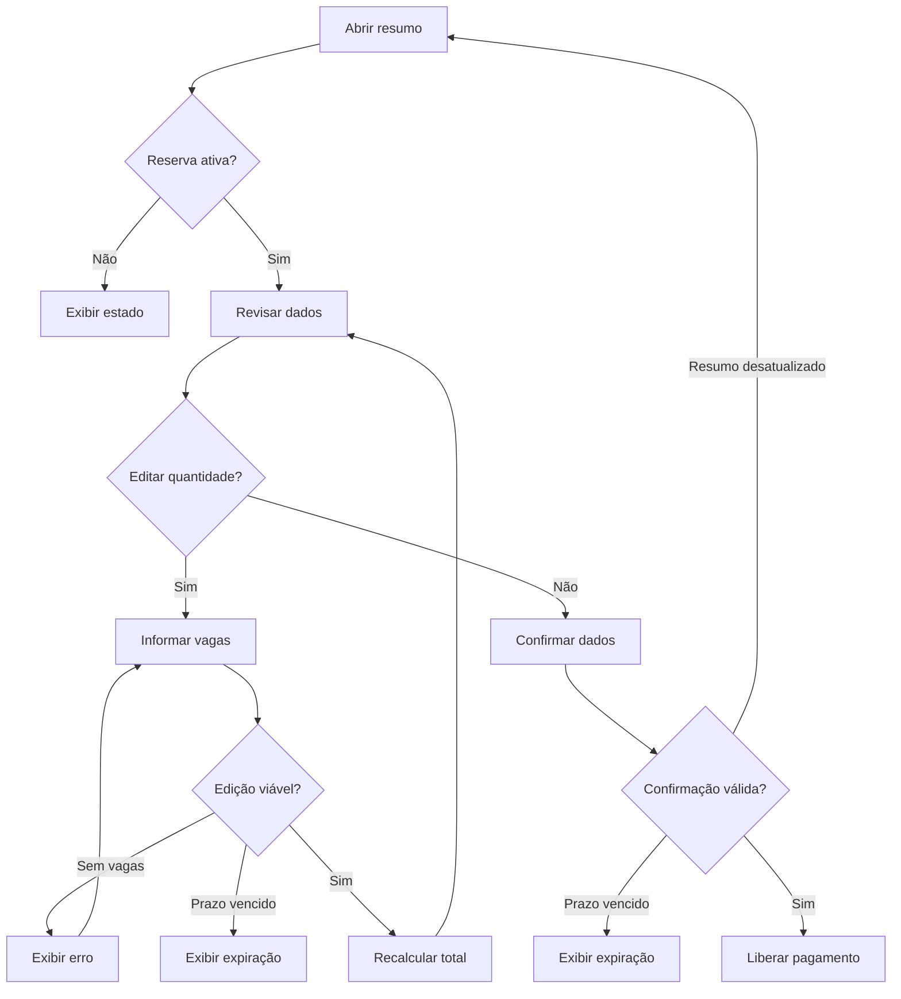

# US09 — Revisar e confirmar reserva

!!! success "Dentro do MVP"
    Esta história faz parte do escopo definido para o MVP.

## Rastreabilidade

| Vínculo | Item |
| --- | --- |
| Requisito funcional | [RF13](../documento-visao/8_requisitos.md#rf13) — Confirmar reserva |
| Épico | [EP04](../planejamento/rastreabilidade.md#ep04) — Reserva e pagamento |
| Tema | [T02](../planejamento/rastreabilidade.md#t02) — Ecoturismo e Reservas |
| Característica de produto | [CP3](../documento-visao/2_solucao.md#cp3) — Módulo Transacional de Ecoturismo |
| Objetivo específico | [OE2](../documento-visao/2_solucao.md#oe2) |
| Ciclo Planejado | Ciclo ? (Incremento ?) |
| Maturidade | Preparada para Construção?? (DoR atendida?) |
| Regras de negócio | [RN04](../documento-visao/8_requisitos.md#rn04) |
| Requisitos não funcionais | [RNF01](../documento-visao/8_requisitos.md#rnf01), [RNF02](../documento-visao/8_requisitos.md#rnf02), [RNF04](../documento-visao/8_requisitos.md#rnf04), [RNF05](../documento-visao/8_requisitos.md#rnf05), [RNF08](../documento-visao/8_requisitos.md#rnf08) |
| Issue | [#62](https://github.com/mdsreq-fga-unb/REQ-2026.2-T01-IBRADA-NET/issues/62) |

## História de usuário

> Como cliente, quero visualizar um resumo completo da minha reserva e confirmar os dados antes do pagamento, para validar as informações do passeio e os valores, evitando erros ou cobranças indevidas.

## Critérios de aceitação

- [ ] Antes do pagamento, o sistema deve exibir um resumo da reserva com experiência, data, quantidade, valores e condições.
- [ ] O sistema deve permitir que o cliente volte e altere os dados da reserva antes de confirmá-la.
- [ ] O sistema só deve prosseguir para o pagamento após a confirmação explícita dos dados pelo cliente.

*Fonte: [issue #62](https://github.com/mdsreq-fga-unb/REQ-2026.2-T01-IBRADA-NET/issues/62).*

## Diagrama de atividades

A reserva está ativa enquanto estiver pendente e dentro do prazo. O resumo exibe experiência, data, quantidade, valores e condições. Ao salvar uma edição, o sistema recalcula o total e volta à revisão. O pagamento da US10 só é liberado depois que o cliente confirma a versão atual do resumo dentro do prazo.

## DoR e DoD

A verificação segue a [Definition of Ready](../documento-visao/9_dor_dod.md#91-definition-of-ready-dor) e a [Definition of Done](../documento-visao/9_dor_dod.md#92-definition-of-done-dod) do projeto.
