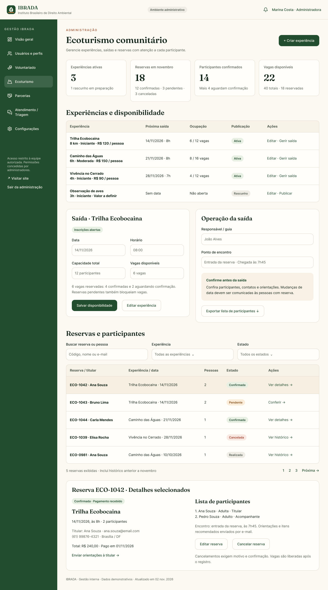

# US11 — Cadastrar pacote de ecoturismo

!!! success "Dentro do MVP"
    Esta história faz parte do escopo definido para o MVP.

## Rastreabilidade

| Vínculo | Item |
| --- | --- |
| Requisito funcional | [RF15](../documento-visao/8_requisitos.md#rf15) — Cadastrar pacotes de ecoturismo |
| Épico | [EP05](../planejamento/rastreabilidade.md#ep05) — Gestão de experiências e pacotes |
| Tema | [T02](../planejamento/rastreabilidade.md#t02) — Ecoturismo e Reservas |
| Característica de produto | [CP3](../documento-visao/2_solucao.md#cp3) — Módulo Transacional de Ecoturismo |
| Objetivo específico | [OE2](../documento-visao/2_solucao.md#oe2) |
| Regras de negócio | — |
| Requisitos não funcionais | [RNF01](../documento-visao/8_requisitos.md#rnf01), [RNF04](../documento-visao/8_requisitos.md#rnf04) |
| Issue | [#64](https://github.com/mdsreq-fga-unb/REQ-2026.2-T01-IBRADA-NET/issues/64) |

## História de usuário

> Como gestor do IBRADA, quero cadastrar novos pacotes de ecoturismo, informando seus roteiros, datas, valores e disponibilidade, para oferecê-los aos clientes interessados.

## Critérios de aceitação

- [x] O sistema deve verificar o preenchimento dos campos obrigatórios da experiência (roteiro, fotos de divulgação, datas, valores e disponibilidade).
- [x]  O acesso ao formulário é restrito a gestores autenticados (RNF04). O cadastro de experiências deve ser permitido apenas ao gestor autenticado.
- [x] O sistema deve retornar uma mensagem de erro caso o cadastro não seja concluído e uma mensagem de sucesso caso a experiência seja salva.
- [x] A experiência cadastrada deve aparecer no catálogo conforme sua disponibilidade.

*Fonte: [issue #64](https://github.com/mdsreq-fga-unb/REQ-2026.2-T01-IBRADA-NET/issues/64).*

## Informações do pacote cadastradas pelo gestor

As informações exibidas no catálogo (US02) e na página de detalhes (US03) vêm do cadastro do pacote, sem valores fixos no site:

| Campo | Obrigatório | Onde aparece |
| --- | --- | --- |
| Local de atuação, comunidade anfitriã, bioma e dificuldade | Sim, porém comunidade anfitriã tem que ser opcional | Card do catálogo e cabeçalho do detalhe |
| Data de início e de término | Sim | Período exibido no detalhe e duração do pacote |
| Ponto e horário de encontro | Sim | Detalhe |
| O que está incluso | Sim (ao menos um item) | Detalhe |
| Regras de conservação, recomendações de vestuário, impacto na comunidade, guia local e máximo de pessoas por reserva (padrão 6) | Não | Detalhe; a seção é omitida quando não cadastrada |

Cada pacote tem uma única data (início e término). Uma nova saída é cadastrada como outro pacote.

## Protótipo

<!-- Inserir aqui a captura do protótipo, por exemplo:  -->

*Espaço reservado para a captura da prototipação desta história.*

## DoR e DoD

A verificação segue a [Definition of Ready](../documento-visao/9_dor_dod.md#91-definition-of-ready-dor) e a [Definition of Done](../documento-visao/9_dor_dod.md#92-definition-of-done-dod) do projeto.
