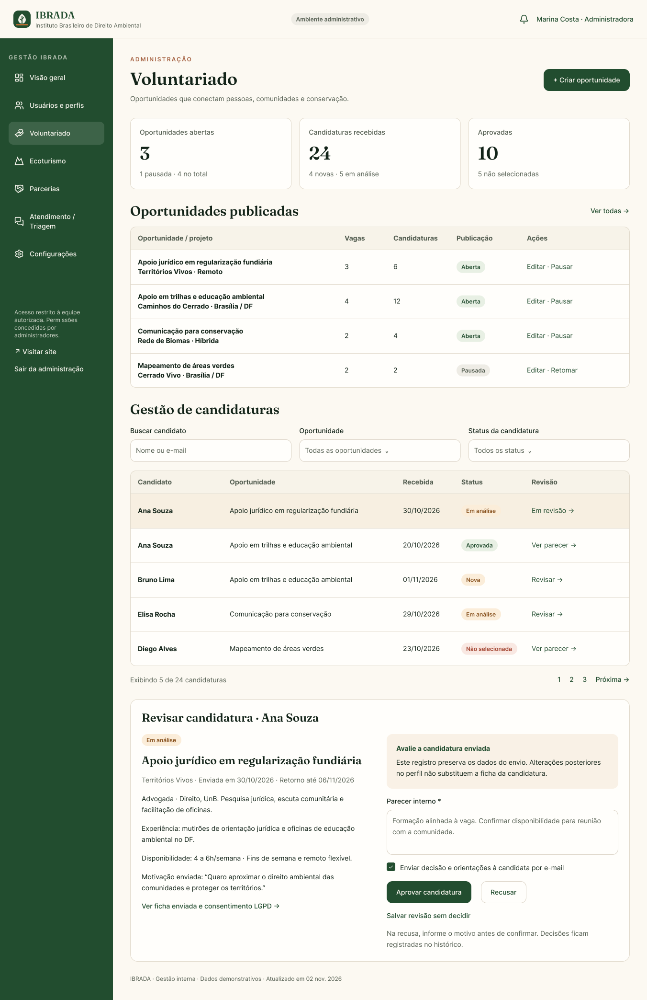

# US18 — Visualizar candidatos em funil

!!! success "Dentro do MVP"
    Esta história faz parte do escopo definido para o MVP.

## Rastreabilidade

| Vínculo | Item |
| --- | --- |
| Requisito funcional | [RF28](../documento-visao/8_requisitos.md#rf28) — Visualizar candidatos |
| Épico | [EP08](../planejamento/rastreabilidade.md#ep08) — Gestão de oportunidades e candidatos |
| Tema | [T03](../planejamento/rastreabilidade.md#t03) — Voluntariado |
| Característica de produto | [CP4](../documento-visao/2_solucao.md#cp4) — Gestão do Ciclo de Voluntariado |
| Objetivo específico | [OE3](../documento-visao/2_solucao.md#oe3) |
| Ciclo Planejado | Ciclo ? (Incremento ?) |
| Maturidade | Preparada para Construção?? (DoR atendida?) |
| Regras de negócio | [RN05](../documento-visao/8_requisitos.md#rn05) |
| Requisitos não funcionais | [RNF01](../documento-visao/8_requisitos.md#rnf01), [RNF04](../documento-visao/8_requisitos.md#rnf04), [RNF08](../documento-visao/8_requisitos.md#rnf08) |
| Issue | [#68](https://github.com/mdsreq-fga-unb/REQ-2026.2-T01-IBRADA-NET/issues/68) |

## História de usuário

> Como gestor membro da equipe do IBRADA, quero visualizar os candidatos voluntários de uma oportunidade em formato de funil, para acompanhar com clareza o processo de triagem e seleção.

## Critérios de aceitação

- [ ] O sistema deve exibir ao gestor os candidatos de uma oportunidade agrupados por etapa do funil.
- [ ] O sistema deve filtrar os candidatos aptos de acordo com os critérios definidos no cadastro da oportunidade.
- [ ] Cada candidato deve exibir as informações de seu perfil (habilidades, experiências e disponibilidade) para a análise do gestor.
- [ ] O acesso ao funil de candidatos deve ser permitido apenas ao gestor autenticado.

*Fonte: [issue #68](https://github.com/mdsreq-fga-unb/REQ-2026.2-T01-IBRADA-NET/issues/68).*

!!! note "Estado da implementação (RN05)"
    A regra de filtragem está implementada no back como `FunilService.filtrarCandidatos`, usando os critérios que o gestor escolhe no cadastro da oportunidade (US13): experiência na área, escolaridade mínima e habilidades exigidas. A escolaridade compara só o nível, sem considerar se o curso está completo. As habilidades são comparadas, como tags completas, com as declaradas em `outros` no perfil do voluntário. Ainda não há rota HTTP nem tela do funil: o serviço está pronto para ser usado por elas.

## Protótipo

<!-- Inserir aqui a captura do protótipo, por exemplo:  -->

*Espaço reservado para a captura da prototipação desta história.*

## DoR e DoD

A verificação segue a [Definition of Ready](../documento-visao/9_dor_dod.md#91-definition-of-ready-dor) e a [Definition of Done](../documento-visao/9_dor_dod.md#92-definition-of-done-dod) do projeto.
