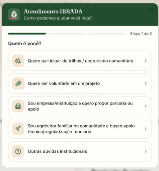
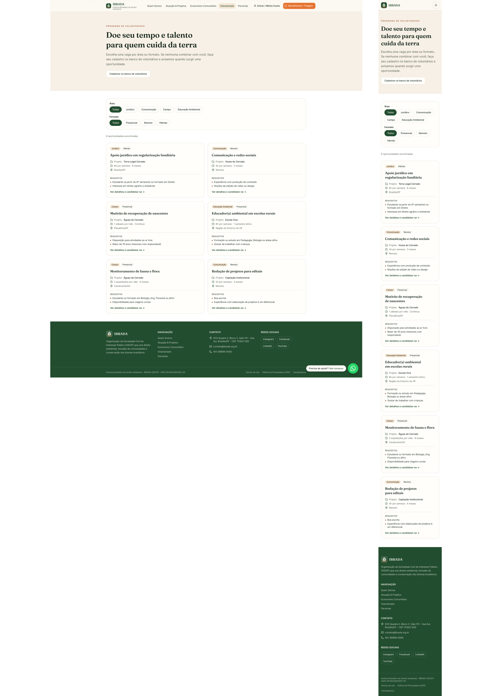

# US21 — Consultar oportunidades abertas

!!! success "Dentro do MVP"
    Esta história faz parte do escopo definido para o MVP.

## Rastreabilidade

| Vínculo | Item |
| --- | --- |
| Requisito funcional | [RF21](../documento-visao/8_requisitos.md#rf21) — Listar oportunidades de voluntariado |
| Épico | [EP07](../planejamento/rastreabilidade.md#ep07) — Descoberta e candidatura |
| Tema | [T03](../planejamento/rastreabilidade.md#t03) — Voluntariado |
| Característica de produto | [CP4](../documento-visao/2_solucao.md#cp4) — Gestão do Ciclo de Voluntariado |
| Objetivo específico | [OE3](../documento-visao/2_solucao.md#oe3) |
| Ciclo Planejado | Ciclo 6 (Incremento 3) |
| Maturidade | Preparada para Construção?? (DoR atendida) |
| Dependências | [US13](us13.md) (Oportunidades cadastradas), [RNF01](../documento-visao/8_requisitos.md#rnf01), [RNF04](../documento-visao/8_requisitos.md#rnf04), [RNF07](../documento-visao/8_requisitos.md#rnf07), [RNF08](../documento-visao/8_requisitos.md#rnf08) |
| Issue | [#46](https://github.com/mdsreq-fga-unb/REQ-2026.2-T01-IBRADA-NET/issues/46) |

## História de usuário

> Como interessado em voluntariado, quero consultar as oportunidades abertas, para encontrar formas de contribuir compatíveis com meus interesses e disponibilidade.

## Critérios de aceitação

- [ ] O sistema deve exibir uma lista de todas as oportunidades de voluntariado abertas.
- [ ] Cada item da lista deve exibir informações resumidas como nome, duração e disponibilidade.
- [ ] A página deve oferecer filtros por área de atuação e busca textual pelo título da vaga.
- [ ] O sistema deve permitir que o usuário selecione a oportunidade e direcione para sua própria seção.
- [ ] Se não houver vagas abertas, exibir uma mensagem acolhedora convidando o visitante a cadastrar seu perfil de interesse (US15).

*Fonte: [issue #46](https://github.com/mdsreq-fga-unb/REQ-2026.2-T01-IBRADA-NET/issues/46).*

## Protótipo

<!-- Inserir aqui a captura do protótipo, por exemplo:  -->

[link figma](https://www.figma.com/design/SU7j4U8GF1JhTSURf4a8Tf/Ibrada---net?node-id=0-1&t=9RMd3X9dpPFAitxH-1)
*Espaço reservado para a captura da prototipação desta história.*

## DoR e DoD

A verificação segue a [Definition of Ready](../documento-visao/9_dor_dod.md#91-definition-of-ready-dor) e a [Definition of Done](../documento-visao/9_dor_dod.md#92-definition-of-done-dod) do projeto; o status de cada item é registrado na [issue #46](https://github.com/mdsreq-fga-unb/REQ-2026.2-T01-IBRADA-NET/issues/46).
