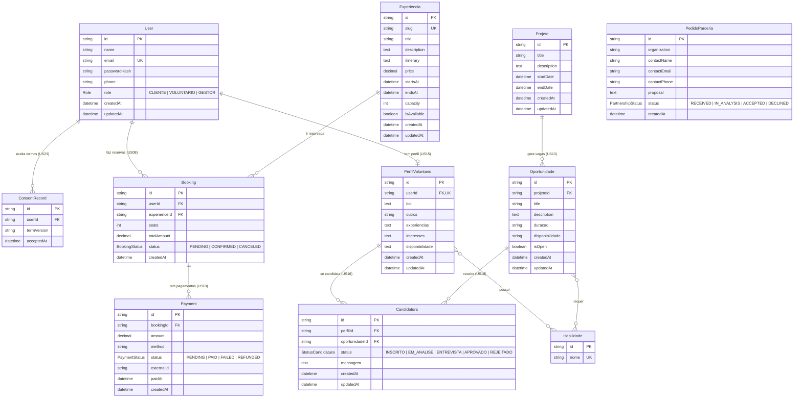

# Modelagem de dados – IBRADA-NET

Gerado a partir de `REQ-2026.2-T01-IBRADA-NET/src/back/prisma/schema.prisma` (MySQL).
Para visualizar o diagrama: abra este arquivo no VS Code com a extensão "Markdown Preview Mermaid Support", ou cole o bloco em https://mermaid.live.

## Diagrama ER

> `PedidoParceria` aparece sem linhas de relação de propósito: quem envia a solicitação é visitante, sem conta (US19).
> `Candidatura` tem restrição única em (`perfilId`, `oportunidadeId`): ninguém se candidata duas vezes à mesma vaga.
> As ligações `}o--o{` com `Habilidade` viram tabelas de junção automáticas no banco (relação muitos-para-muitos implícita do Prisma).

## Resumo por tema

| Tema | Tabelas | User stories |
| --- | --- | --- |
| Conta e LGPD | `User`, `ConsentRecord` | US04–US07, US17, US22, US23 |
| Ecoturismo e reservas | `Experiencia`, `Booking`, `Payment` | US02, US03, US08–US12 |
| Voluntariado | `Projeto`, `Oportunidade`, `Candidatura`, `PerfilVoluntario`, `Habilidade` | US13–US18, US21 |
| Parcerias | `PedidoParceria` | US19, US20 |

## Enums

| Enum | Valores |
| --- | --- |
| `Role` | CLIENTE, VOLUNTARIO, GESTOR |
| `BookingStatus` | PENDING, CONFIRMED, CANCELED |
| `PaymentStatus` | PENDING, PAID, FAILED, REFUNDED |
| `PartnershipStatus` | RECEIVED, IN_ANALYSIS, ACCEPTED, DECLINED |
| `StatusCandidatura` | INSCRITO, EM_ANALISE, ENTREVISTA, APROVADO, REJEITADO |
